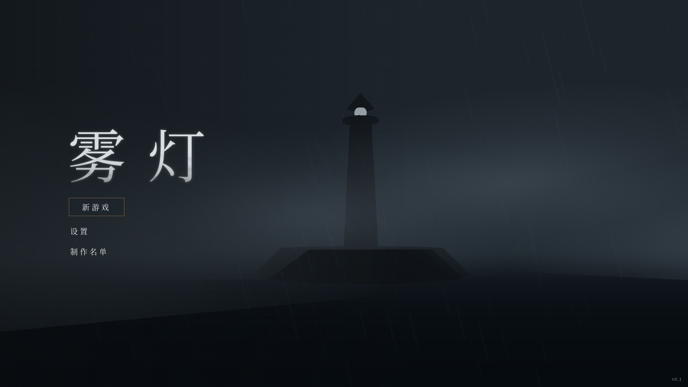
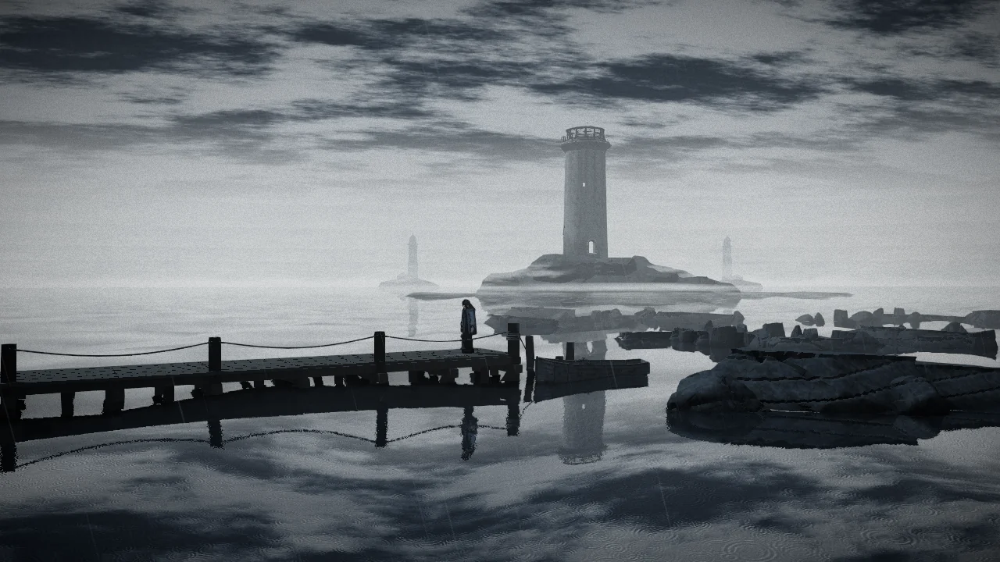

# 雾灯 · Foglight

A melancholic third-person exploration puzzle, played in the desktop browser.

在雾与雨笼罩的群岛上，守灯人的孩子独自登上熄灭的灯塔，借光的反射和潮水的涨落把它们重新点亮，也一点点靠近父亲没有回来的原因。

<p align="center">
  
</p>

<p align="center">
  
</p>

## 简介

《雾灯》是一款面向桌面浏览器的 3D 第三人称探索解谜游戏。画风为三渲二半写实，整体偏低饱和的冷色，暖光只出现在关键处。

你扮演 13 岁的守灯人女儿**汐**。群岛常年阴天、浓雾、细雨，灯塔一座接一座熄灭，岛上的人陆续离开。三个月前，父亲驾船去点外围的灯，再没有回来。汐独自划船回到空无一人的家乡小岛，提着一盏黄铜风灯，把父亲没做完的事接着做下去。

剧情几乎不靠大段对白，而是写在信件、日志、遗物和场景细节里。谜题的答案藏在环境中，靠观察和思考得出，不靠反应或试错。

**第一章「归岸」**包含三个小场景、五道谜题，设计时长约 20–30 分钟：从落潮的码头，到守灯人小屋，再到岛上的第一座灯塔。后续章节尚在规划，不在本版本范围内。

## 特色

- **两种核心机制，反复组合**：转动镜子引导光线，敲响潮汐钟让海水涨落。
- **看懂再动手**：对准、站位、环顾都会改变你看到的东西；不要求精确到一度，但需要你真的去看。
- **环境叙事**：字幕很短，日志和场景负责把故事留给你自己拼起来。
- **忧郁的氛围**：体积雾、细雨、水面反射、灯塔暖光，以及与之相配的环境音和配乐。
- **画质分档**：极致 / 高 / 标准，首次启动自动检测，可在设置里随时改回。
- **本地存档**：进度、设置、已读信件都存在浏览器本地，无需账号。

## 操作

键鼠操作，点击游戏画面锁定鼠标后即可转动视角。若浏览器不允许指针锁定，按住左键拖拽同样可以转视角。本作没有跳跃。

| 操作 | 按键 |
|---|---|
| 移动 | <kbd>W</kbd> <kbd>A</kbd> <kbd>S</kbd> <kbd>D</kbd> 或方向键 |
| 小跑 | 按住 <kbd>Shift</kbd> |
| 转视角 | 鼠标移动（锁定后） |
| 交互 | <kbd>E</kbd> |
| 观察（拉近） | 按住右键 |
| 相机远近 | 滚轮 |
| 提示 | <kbd>H</kbd> |
| 日志 | <kbd>J</kbd> |
| 暂停 | <kbd>Esc</kbd>（任何时候） |
| 推进字幕 | 左键或 <kbd>空格</kbd> |
| 跳过演出 | 按住 <kbd>空格</kbd> 约 1 秒 |

进入机关后，相机会切到预设机位，用鼠标或 <kbd>A</kbd> / <kbd>D</kbd> 旋转部件（按住 <kbd>Shift</kbd> 精调），<kbd>Q</kbd> / <kbd>E</kbd> 或滚轮切换部件，<kbd>R</kbd> 复位，右键或 <kbd>Tab</kbd> 退出。阅读信件和日志时，同样用右键或 <kbd>Tab</kbd> 关闭，<kbd>A</kbd> / <kbd>D</kbd> 翻页。

手柄和触屏不是本版本的目标，后续再考虑。

## 技术栈

- 渲染与场景：[Three.js](https://threejs.org/)（r186），后处理使用 `postprocessing` 与 `n8ao`，碰撞网格使用 `three-mesh-bvh`
- 语言与构建：[TypeScript](https://www.typescriptlang.org/) + [Vite](https://vite.dev/)
- 资源：glTF / GLB 模型，KTX2 压缩贴图，WOFF2 字体子集
- 运行环境：Node.js ≥ 22.18

## 快速开始

需要 Node.js 22.18 或更高版本。运行时美术已包含在仓库的 `art/` 目录中，位于 `game/` 的上一级（与 Vite 的映射一致）。

```bash
git clone https://github.com/worldv4nquisher-cyber/foglight-game.git
cd foglight-game/game
npm ci
npm run dev
```

然后打开 [http://localhost:5173](http://localhost:5173)。

| 命令 | 作用 |
|---|---|
| `npm ci` | 按锁文件安装依赖（在 `game/` 目录下执行） |
| `npm run dev` | 开发服务器（默认 5173 端口，支持热更新） |
| `npm run build` | 类型检查并打包到 `game/dist/` |
| `npm run preview` | 本地预览生产构建（默认 4173 端口） |

`dist/` 使用相对路径，可以放到任意静态服务器的子目录。不要直接双击 `dist/index.html`（`file://` 会被浏览器拦截 ES 模块和 wasm），请用 `npm run preview` 或任意静态服务器打开。

## 项目结构

```
foglight-game/
├─ game/                 游戏代码（Three.js + TypeScript + Vite）
│  ├─ public/assets/fonts/  中文字体子集与 OFL 许可证
│  ├─ src/               场景、系统、UI 与文案
│  └─ scripts/           校验、字体子集、冒烟测试
├─ art/                  运行时模型、贴图、音频、UI（开发时映射为 /assets/art/）
├─ docs/                 设计文档、版本计划、缺陷与测试报告
├─ audio/CREDITS.md      音频授权摘要
├─ LICENSE               MIT 许可证
└─ README.md
```

## 文档

`docs/gdd/` 是已定稿的游戏设计文档，**包含完整剧情与全部结局，阅读即会遇到剧透**。版本计划、兼容与性能报告在 `docs/releases/`，缺陷单与 QA 报告在 `docs/bugs/`，需求单在 `docs/tasks/`。内部工程说明见 [`game/docs/engineering.md`](game/docs/engineering.md)。

## 浏览器与性能

面向**桌面浏览器**：Chrome、Edge、Firefox、Safari。手机不是目标平台。

画质与性能目标（尚未在目标硬件上填写实测帧率）：

- 推荐：RTX 3060 级显卡，2560×1440，极致档，目标 60 fps
- 最低：GTX 1650 级显卡，1920×1080，标准档
- 包体预算：主菜单 ≤ 15 MB，首场景（公共资源 + 第一场景）≤ 150 MB

## 版本状态

当前是 **v0.1 候选版**，尚未对外发布。第一章已可完整游玩，正在等待实机试玩确认后再决定是否发行。

## 制作团队

| 职责 | |
|---|---|
| 制作人（兼测试） | [worldv4nquisher-cyber](https://github.com/worldv4nquisher-cyber) |
| 策划、美术、程序 | Grok Bot |

## 许可

本仓库的代码、美术与文档以 [MIT License](LICENSE) 授权，版权所有 © 2026 worldv4nquisher-cyber。

第三方例外：

- 中文字体子集（`game/public/assets/fonts/`）来自思源黑体 / 思源宋体（Noto CJK），遵循 [SIL Open Font License 1.1](game/public/assets/fonts/OFL.txt)，不是 MIT。
- 配乐中的钢琴与弦乐采样来自 VSCO 2 CE，遵循 CC0 1.0；曲目本身与其余音效、模型、贴图均为团队自制。逐条来源见 [`art/CREDITS.md`](art/CREDITS.md)、[`audio/CREDITS.md`](audio/CREDITS.md) 与 [`docs/audio-credits.md`](docs/audio-credits.md)。
