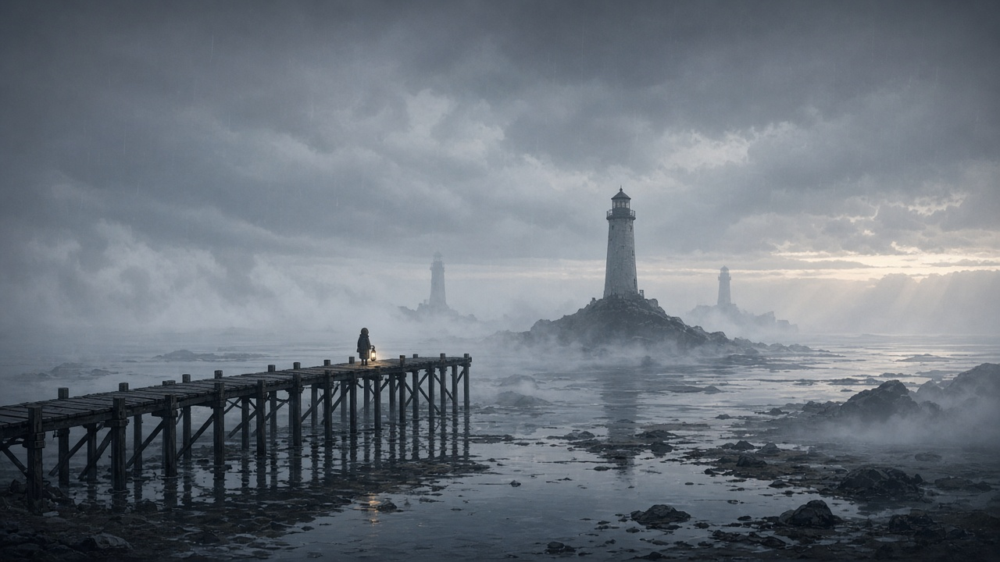
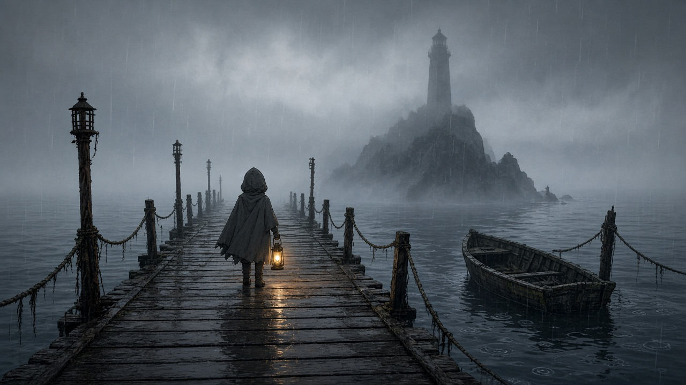
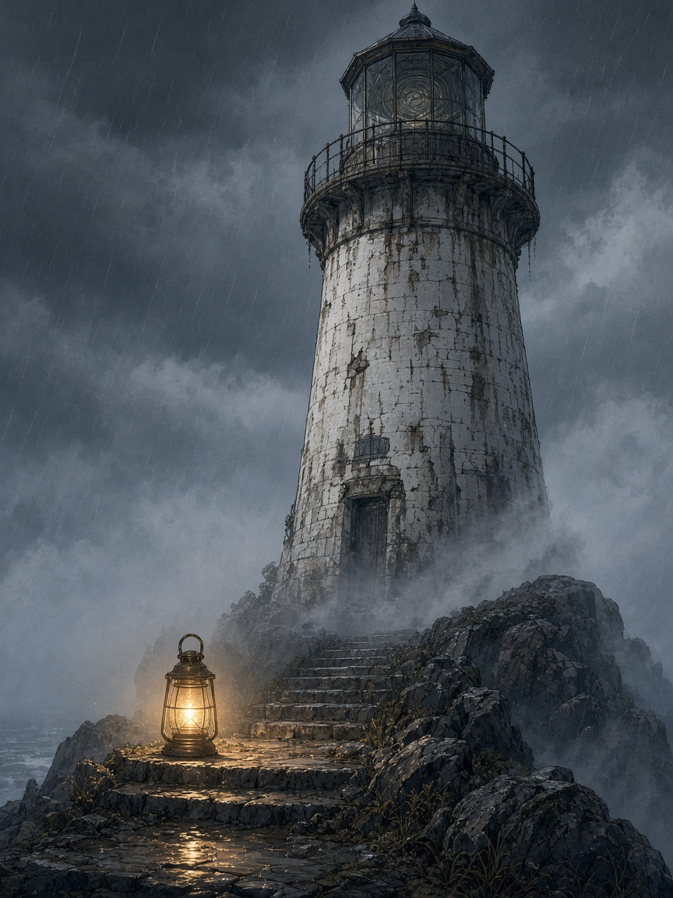
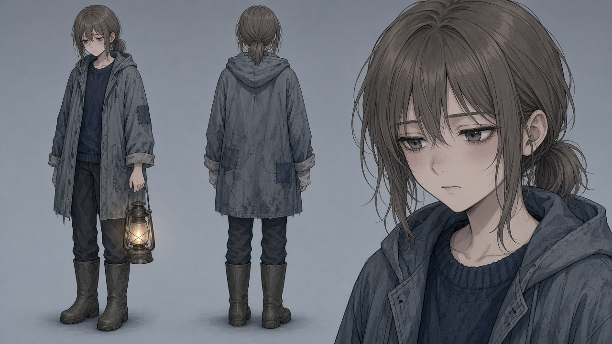
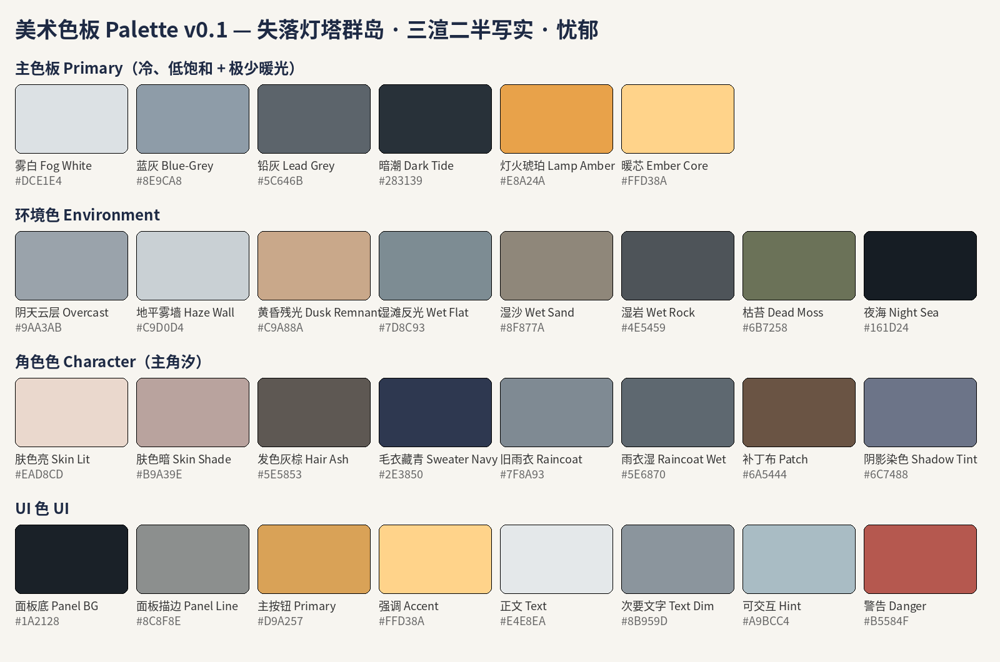

# 美术风格指南 v0.1（初稿）— 失落灯塔群岛

> 负责人：美术｜对应里程碑：v0.1 M3「美术风格指南 + 氛围样张」｜更新：2026-10-29
> **平台：桌面优先，用户 10/29 确认。**（桌面浏览器，独显或较新核显；优先 WebGL2，可用时走 WebGPU；目标 60fps，不再考虑手机。）
> 画风：**三渲二（cel / toon shading）半写实、场景极致精致**（用户确认）。氛围：**忧郁**（用户确认）。
> 题材：第三人称小场景探索解谜。主角汐（13 岁女孩，守灯人的女儿）在雾中群岛之间，重新点亮熄灭的灯塔；谜题围绕光线反射和潮汐升降展开。

样张（第一章开场）：

| 文件 | 内容 |
|---|---|
|  `concept-ch1-opening-wide.png` | 开场远景：阴天黄昏、细雨、栈桥、熄灭的灯塔、层层雾墙，栈桥上孤零零的小人是主角汐（女孩） |
|  `concept-ch1-opening-pier.png` | 栈桥第三人称视角：主角汐（女孩）的背影，湿木反光、雨圈、半沉的小船，她手里的风灯是唯一暖色 |
|  `concept-ch1-lighthouse-closeup.png` | 灯塔近景：湿石材、锈迹、死寂的灯室、风灯的体积光锥 |
|  `concept-ch1-xi-character.png` | 角色参考：主角汐，13 岁女孩（正、背、脸部特写；背面视图漏画了风灯，以正面为准，暂不重画） |
|  `palette.png` | 色板 |

> 说明：AI 样张偏「厚涂/写实插画」，**描边和色阶比实际游戏画面软**。真正的着色规则以本文第 1 节为准，样张主要用来看构图、色调、雾和光的氛围。

---

## 0. 氛围核心：忧郁

一句话：**冷、湿、空、静，只有一点暖。**

- **冷而低饱和**：画面 90% 以上是蓝灰、铅灰、雾白。环境色饱和度（HSV S）一般不超过 25%，暗部往冷蓝偏。
- **暖色少而珍贵**：灯塔、风灯、被点亮的光束用琥珀和暖黄，是画面里**唯一的温度**。同屏暖色面积平时不超过画面的 15%（点灯高潮那几秒可放宽到约 30%）。环境里不准出现其他暖色光源（不要篝火、不要暖色窗光、不要橙色晚霞铺满天）。**例外：汐的风灯**可以被她放下；风灯放在屋里时，从窗口透出的暖光算作风灯的光，允许（如 S2 小屋窗光）。除此之外的窗光一律用冷色或不亮。黄昏只留地平线上一道发灰的残光（`#C9A88A`）。
- **天气**：默认阴天和黄昏，常态细雨或雨后。地面、木头、岩石都是湿的，有反光。晴天只在章节结尾「点亮之后」短暂出现，而且还是薄云。
- **空旷与留白**：构图上天空和雾至少占 40% 到 60%。中景故意留出大面积空的水面或雾。不要把每个角落都填满道具，「精致」体现在少量物件做到极致，不在数量。
- **孤独的尺度感**：主角汐在远景镜头里只占画面高度的 1/10 到 1/15。灯塔和岩岛高而远，栈桥长到看不到头。相机多用远景、低机位、背影。
- **层叠的雾**：远处至少 3 到 5 层雾墙，越远越白、越平，其他灯塔的剪影在雾里若隐若现。看得见却到不了，这本身就是忧郁。
- **静**：动画节奏慢。水面几乎平静，只有雨圈；风小，雾慢慢漂。远处允许偶尔出现**零星的单只海鸟**（远景、慢、低对比，不进中近景），但**不要鸟群**，也不要热闹的生物。
- **反例（不要做）**：糖果色、高饱和蓝天绿草、阳光明媚的「原神式」大世界色调、满屏特效、恐怖或惊悚（忧郁不等于吓人，不要血腥、不要怪物剪影、不要跳吓）。

## 1. 画风定义：三渲二半写实

| 项目 | 规则 |
|---|---|
| 明暗分级 | 角色 **2 级**（亮 / 暗），交界线硬但带 1 到 2 px 的软过渡；场景 **3 级**（亮 / 半影 / 暗），过渡比角色软。暗部不能是纯灰，要乘阴影染色（角色 `#6C7488`，场景偏蓝灰）。 |
| 描边 | 角色和重要道具：反向法线外扩描边（inverted hull），线色为本体固有色压暗 60% 后偏冷，**不用纯黑**；线宽按屏幕空间恒定，角色约 1.5 px（1080p）。场景：后处理法线 + 深度 + 物体 ID 边缘检测，线更细（约 1 px），远处随雾淡出。两种描边组合使用。 |
| 高光 | 金属、湿表面、头发用**风格化硬边高光**（阶梯化的 specular 色带）；皮肤、布料基本不加高光。头发要有一条各向异性高光带。 |
| 边缘光 | 只在背光侧加一道细的冷色边缘光（雾白 `#DCE1E4`，强度低）；靠近风灯或灯塔时边缘光变成琥珀色。这是让「暖色珍贵」的主要手法之一。 |
| 写实程度 | 比例、结构、材质纹理接近写实（石块、木纹、锈迹、苔藓都看得清）；明暗、阴影和描边按动漫规则处理。脸部完全动漫化。 |
| 材质 | 漫反射贴图要手绘质感（色块加笔触），不要照片扫描；法线贴图只保留中大尺度的形体（石缝、木板缝），微观细节画在颜色里。粗糙度贴图用来做湿和干的区分：湿区域粗糙度低，在阶梯化高光中反光。 |
| 要做到 | 轮廓清楚；冷色主调下层次分明；湿的质感；雾里的层次；暖光一出现就是焦点。 |
| 不要做成 | 写实 PBR 画面（脏、灰、没有色阶）；纯平涂低多边形；全黑描边的美式卡通；过曝的 bloom；高饱和的童话色。 |

## 2. 配色

见 `palette.png`。

**主色板（冷、低饱和 + 极少暖光）**

| 名称 | Hex | 用途 |
|---|---|---|
| 雾白 Fog White | `#DCE1E4` | 雾、远景、天空亮部 |
| 蓝灰 Blue-Grey | `#8E9CA8` | 中景主体、水面 |
| 铅灰 Lead Grey | `#5C646B` | 岩石、云层暗部 |
| 暗潮 Dark Tide | `#283139` | 最暗部、深水、夜 |
| 灯火琥珀 Lamp Amber | `#E8A24A` | 灯塔光、风灯（唯一暖色） |
| 暖芯 Ember Core | `#FFD38A` | 光源核心、光束最亮处 |

**环境色**：阴天云层 `#9AA3AB`、地平雾墙 `#C9D0D4`、黄昏残光 `#C9A88A`（只用在地平线细带上）、湿滩反光 `#7D8C93`、湿沙 `#8F877A`、湿岩 `#4E5459`、枯苔 `#6B7258`、夜海 `#161D24`。

**角色色（主角汐）**：肤色亮 `#EAD8CD`、肤色暗 `#B9A39E`、发色灰棕 `#5E5853`、毛衣藏青 `#2E3850`、旧油布雨衣（褪色）`#7F8A93`（湿时压暗到约 `#5E6870`）、补丁布 `#6A5444`、阴影染色 `#6C7488`。角色整体也要低饱和，只靠明度和剪影从背景中分出来；风灯是角色身上唯一的暖色。

**UI 色**：面板底 `#1A2128`（80% 不透明）、面板描边 `#8C8F8E`、主按钮 `#D9A257`、强调 `#FFD38A`、正文 `#E4E8EA`、次要文字 `#8B959D`、可交互提示 `#A9BCC4`、警告 `#B5584F`。

## 3. 光照、雾与后处理

### 3.1 光照
- **主光**：1 盏方向光，模拟阴天的天光。色温偏冷（`#C9D3DC`），强度低，阴影边缘偏软。黄昏时在地平线方向叠一道极弱的暖色残光。
- **环境光**：天空球加地面半球光（天 `#9AA3AB` / 地 `#3A4248`），或者烘焙的 SH 光照探针。暗部不能死黑。
- **暖光源**：汐的风灯（点光，带阴影；提在手里时跟随汐，放下后固定在原处）、被点亮的灯塔（聚光加体积光束，会转动）。谜题的反射光线**颜色跟随光源**：风灯发出的光（谜题 3）是暖色，云缝天光（谜题 5）是冷白色。暖光数量严格控制，同屏带阴影的暖光不超过 2 盏。
- **引导用冷色，不用暖光**：S1 落潮滩没有任何环境暖光（不放油灯）。引导靠潮汐钟：湿铜材质，在灰暗场景里给一道明显的**冷色高光**（阶梯化 specular，色近雾白 `#DCE1E4`，略偏青），开场建立镜头扫过它；配合风吹的轻响和敲响后的钟声做声音引导。其他场景的引导物也优先用冷色高光、明度对比和声音，不用暖光。
- **谜题 5 的冷白天光**：从雨云缝隙漏下的光用冷白色（约 `#E6EEF2`，色温偏冷，不带黄），经三面镜子一路到点火口的整条光路在点火前都保持冷白。**只有点火口点燃、主灯亮起的那一刻，画面才转暖**（光束、灯室、LUT 一起过渡到暖，暖色占比这几秒可放宽到约 30%），这是整章唯一的暖色高潮。
- **烘焙**：静态场景烘焙光照贴图和 AO（Blender 烘好后导出 lightmap），实时光只负责角色、动态物体和暖光。
- **时段预设**：`overcast-dusk`（默认）、`rain-night`（夜里只靠风灯和灯塔）、`after-lit`（点灯后，雾稍散，薄云，暖光束扫过海面）。每个预设是一组参数：主光颜色和强度、雾密度和颜色、LUT、雨量。

### 3.2 天空与雾
- 天空：程序化渐变天空加手绘云层贴图（低饱和、厚重的层云），云慢慢漂。
- 雾：**极致档**用真体积雾（froxel 体素雾或 raymarch），高度雾（海面最浓、往上变淡）加距离雾，雾受暖光照亮，会形成光柱。远景另外放 3 到 5 层雾墙贴片，保证层次。
- 雨：GPU 粒子雨丝、水面雨圈法线（flipbook）、屏幕上偶尔的水滴（只在特写镜头里用）。

### 3.3 光束
- 极致档和高档用 raymarch 体积光：灯塔光束、风灯光锥、谜题 5 的冷白天光都在体积雾里真实散射。
- 标准档（兜底方案）：假体积贴片。用带加法混合的锥形网格，或者公告板做光束；按深度做软淡出（soft particle），镜头方向和锥体轴线夹角太小时淡出，避免穿帮。

### 3.4 后处理链（按顺序）
GTAO/SSAO → 体积雾/光合成 → SSR/平面反射 → 描边（法线+深度+ID）→ 景深（bokeh）→ Bloom（阈值高，只让暖光和光束发光）→ 色调映射（AgX 或 ACES）→ 调色 LUT（冷调、压饱和、暗部偏蓝）→ 胶片颗粒（轻微，强度 0.03 到 0.05）→ 暗角（轻微）→ TAA 或 SMAA。

## 4. 角色

主角：**汐**（GDD §5.2 暂名），13 岁女孩，守灯人的女儿。话很少，穿父亲改小的旧油布雨衣，提一盏小风灯。参考图见 `concept-ch1-xi-character.png`。GDD 里目前没有更细的外貌设定，下面的发型、配色是美术先定的初稿，策划或用户另定时以他们为准。

- **头身比**：汐约 **6 头身**，按 13 岁少女的比例：身材纤细，肩窄，四肢偏长，还没完全长开；不做成 Q 版，也不做成成人比例。成年 NPC 7 到 7.5 头身。
- **面部**：动漫半写实。灰色眼睛，比成人角色稍大但不夸张；鼻子只用一个小阴影点出，嘴小；脸色偏苍白，脸颊和鼻尖有被冷风吹出的淡红。脸部阴影用 SDF 面部阴影图控制，避免鼻子和脸颊出现难看的阴影。
- **表情和姿态（话少、内敛）**：
  - 默认表情：嘴闭着，视线略往下，眉头有一点点收着；不笑、不哭、不做夸张的动漫表情。情绪靠眼神和很小的动作表达（抿嘴、移开视线、握紧风灯提手）。
  - 姿态：肩膀微微内收，站着时重心放在一条腿上，提灯的手贴近身体；走路步子小而慢。
  - 待机小动作：把手缩进袖子、对着手哈气、拉一下雨衣领口、低头看风灯的火苗。
  - 不做的动作：挥手、跳跃欢呼、叉腰、比剪刀手这类外向的动作。
- **发型**：齐肩、略湿的灰棕色头发（`#5E5853`），在脑后松松地扎一个短低马尾，脸侧和额前垂下几缕散发。分簇建模（12 到 20 簇），碎发要有；一条各向异性高光带；淋雨时发簇更贴、高光更亮。马尾和散发做轻微的骨骼摆动。
- **服装**：
  - **父亲的旧油布雨衣改小的**：仍然略大一号，下摆到膝盖上方，带兜帽（平时放下）；袖口卷起一到两折；颜色褪了，原本的蓝灰褪得发白发灰，接缝和折痕处褪得更厉害；肘部、口袋、下摆有缝上去的补丁（补丁布和针脚都要看得出是手工缝的）；边缘磨损、起毛。
  - **湿了会变深**：用湿度遮罩（顶点色或贴图通道）控制，淋湿的部分颜色压暗约 20% 到 25%、粗糙度降低、出现阶梯化高光；肩部和下摆最先湿。
  - 里面是藏青粗针织毛衣（领口露出），深色长裤塞进旧雨靴；雨靴有泥点和磨痕。
  - 雨衣下摆和兜帽做布料模拟或骨骼摆动。
- **小风灯**：一盏旧的小号防风灯（hurricane lantern），高 25 到 30 厘米；提环和顶盖是旧黄铜，框架是发暗的铁皮，有锈和凹痕，玻璃罩带烟熏（模型 `prop-lantern-brass.glb`）；火苗是琥珀色（`#E8A24A` / 芯 `#FFD38A`），是汐身上唯一的暖色。风灯同时也是游戏里的光源（跟随角色的点光，见第 3 节）和谜题道具，模型做成能单独拿起、放下。
- 原创角色，不能复刻任何已有作品的角色。

## 5. 场景

- **地形**：小岩岛、潮间带浅滩、湿沙和礁石。潮汐升降是玩法核心，所以浅滩要按 2 到 3 个水位分别设计可走区域；水面高度由程序驱动，湿痕线跟着水位变化。
- **建筑**：灰白石砌灯塔（锈迹、剥落、苔藓、水渍）、木栈桥、石阶、守灯人小屋、铁栏杆、绳索、废弃的小船。风格偏北欧和英伦海岸，朴素、旧、实用，不要奇幻华丽。
- **植被**：稀少，只有海草、枯苔、海岸的低矮杂草。草用实例化加风场摆动，颜色发灰。不要大片绿地。
- **远景层次**：近景（角色 0 到 20 m，最精致）→ 中景（岩岛、栈桥，20 到 150 m）→ 远景（其他灯塔岛的剪影，150 m 以上，用 impostor 或贴片）→ 雾墙 3 到 5 层 → 天空。越远饱和度越低、越亮、越平。
- **细节密度**：近景要「近看经得起」：石缝里的水、木板上的钉子锈、绳索的纤维。但整体物件数量克制，留出空旷感。

## 6. UI 风格

- **基调**：克制、安静、少。半透明深色面板（`#1A2128` 80%），细线描边，角上有小小的灯塔或罗盘纹样。HUD 平时隐藏，只在交互时淡入。
- **字体**（都可以免费商用）：
  - 标题：**思源宋体 Source Han Serif / Noto Serif CJK**（SIL Open Font License 1.1）。宋体有书卷感，适合忧郁的叙事气质。
  - 正文和字幕：**思源黑体 Source Han Sans / Noto Sans CJK**（SIL OFL 1.1）。
  - 西文和数字：**Cormorant Garamond**（OFL）或 **Noto Serif**（OFL）。
  - 网页上按章节子集化（只打包用到的字）并转成 WOFF2。
- **按钮**：细描边的矩形，悬停时描边变成琥珀色，并轻微发光。主按钮只用一个。
- **图标**：单色细线（1.5 px）图标，线色 `#E4E8EA`，可交互状态用琥珀色，不要彩色图标。
- **字幕**：底部居中，带浅阴影，不加底框。

## 7. Three.js 实现建议

### 7.1 渲染路线
- **WebGL2**（默认）：`WebGLRenderer` 配合 [pmndrs/postprocessing](https://github.com/pmndrs/postprocessing)（EffectComposer、SMAA、Bloom、DoF、LUT、Noise、Vignette），GTAO 用 three 自带的 `GTAOPass`，或 `n8ao`（MIT 授权）。
- **WebGPU**（检测到 `navigator.gpu` 时用）：`three/webgpu` 的 `WebGPURenderer` 加 TSL 节点材质；后处理用 TSL `PostProcessing`（three 自带 GTAO、Bloom、DoF、SSR 节点）。toon 材质要用 TSL 再写一版。建议从一开始就用 TSL 写材质，同一套代码在 WebGL2 和 WebGPU 都能编译。

### 7.2 Toon 材质
- 不用 `MeshToonMaterial` 的默认效果（太平）。用自定义材质（`onBeforeCompile` 扩展 `MeshStandardMaterial`，或者 TSL 节点）：
  - 漫反射：`NdotL` 经过 **ramp 贴图**（1D 渐变，256×1，可以按材质换）阶梯化，同时保留阴影贴图和光照贴图的输入；
  - 暗部乘阴影染色；
  - 高光：Blinn-Phong 加 `smoothstep` 阶梯化；
  - 边缘光：Fresnel 阶梯化，乘光源方向遮罩；
  - 脸部：SDF 面部阴影贴图，按光源和脸部朝向采样；
  - 头发：Kajiya-Kay 各向异性高光，再阶梯化；
  - 湿度：顶点色或遮罩控制粗糙度和颜色变深。
- 环境（IBL）只取漫反射的 SH，不用强反射，避免材质看起来像 PBR。

### 7.3 描边
| 方案 | 做法 | 代价 | 用在 |
|---|---|---|---|
| 反向法线外扩 | 第二遍渲染，背面剔除，顶点沿平滑法线外扩（平滑法线烘焙在顶点色或 UV 通道里，避免硬边断线） | 描边物体的 draw call 和面数都 ×2 | 角色、可交互道具、近景重点物件 |
| 后处理边缘检测 | 法线 + 深度 + 物体 ID 缓冲做 Sobel/Roberts，线宽和颜色按深度衰减并混入雾色 | 全屏 1 到 2 次采样 pass，约 0.5 到 1 ms（1440p 独显）；需要额外的法线和 ID 缓冲（MRT） | 场景全局 |

组合方式：角色走外扩描边（可控、干净），场景走后处理描边；外扩描边的物体在 ID 缓冲里标记出来，避免描两遍。

### 7.4 阴影
- 主光用级联阴影（`three/addons/csm/CSM.js`，或 WebGPU 的 CSM 节点），PCSS 或 PCF 软阴影；静态物体的阴影走光照贴图，CSM 只投射动态物体加近景。
- 风灯点光的立方体阴影用 512 到 1024 分辨率，只在风灯附近开启。
- 极致档另加屏幕空间接触阴影（让角色脚底和物件的接地感更好）。

### 7.5 水面
平面反射（`Reflector`，按画质档设置分辨率）+ SSR（湿地面）+ 雨圈法线 + 深度着色（浅滩透明到深水暗潮色）+ 岸边泡沫线；按 `tideLevel` 统一驱动。

### 7.6 资源管线
glTF/GLB 用 Draco 或 Meshopt 压缩几何（推荐 Meshopt）；贴图用 **KTX2**（UASTC 用于法线和重要贴图，ETC1S 用于其他），UI 用 WebP；`KTX2Loader` 加 `MeshoptDecoder`。

## 8. 画质分档

四档都针对桌面。**默认「极致」**。「最低」档给没有独显、浏览器走软件渲染的机器（如云端调试机）跑流程、找问题用：只在设置里手动选（或 `?quality=low`），自动检测不会降到这一档；它关掉阴影、平面反射和整条后处理，画面颜色和其余三档不同。画质自动检测只在首次启动后第一次进入 S1 时跑一次：每轮 3 秒，第 1 轮在开场演出尾段的建立镜头内测极致档，平均 < 50 fps 就降一档重测；最多连降两档，第 3 轮只测标准档并记录结果，不再往下降（详见 009）。玩家在设置里手动选的档位和 URL 参数 `?quality=` 优先于检测结果。

下表的参数键名可以直接放进 `game/src/config/quality.ts`：

| 参数（key） | 极致 `ultra`（默认） | 高 `high` | 标准 `standard`（兜底） | 最低 `low`（无独显 / 软件渲染） |
|---|---|---|---|---|
| `renderScale` 渲染分辨率缩放 | 1.0 | 1.0 | 0.8 | 0.5 |
| `maxPixelRatio` | 2.0 | 1.5 | 1.0 | 1.0 |
| `heroCharTris` 主角（汐）三角面 | 120k（lod0） | 50k（lod1，高档和标准档共用） | 50k（lod2 ≤ 25k 用于远景） | 25k（lod2） |
| `npcCharTris` NPC 三角面 | 60k | 40k | 25k | 12k |
| `sceneVisibleTris` 可见场景总面数 | 6M | 3.5M | 1.5M | 1M |
| `maxDrawCalls` | 2000 | 1200 | 600 | 400 |
| `textureMaxSize` 角色/重点道具 | 4096 | 2048 | 2048 | 1024 |
| `textureMaxSizeEnv` 普通环境贴图 | 2048 | 2048 | 1024 | 512 |
| `anisotropy` | 16 | 8 | 4 | 1 |
| `outlineHull` 外扩描边 | 角色+道具+近景 | 角色+道具 | 仅角色和可交互物 | 仅角色和可交互物 |
| `outlinePost` 后处理描边 | 全分辨率，法线+深度+ID，最远 300 m | 全分辨率，法线+深度，最远 150 m | 关闭（远景不描边） | 关闭 |
| `fogMode` 雾 | `volumetric`（froxel 160×90×128） | `volumetric`（半分辨率 froxel 80×45×64） | `cards`（假体积贴片） | `cards`（同标准） |
| `fogCards` 雾墙/雾贴片数 | 远景 5 层 + 补充 ≤ 20 | 远景 5 层 + ≤ 30 | 远景 4 层 + ≤ 40 | 远景 4 层 + ≤ 40（同标准） |
| `lightShafts` 光束 | raymarch 64 步 | raymarch 32 步，半分辨率 | 加法锥形网格 + 公告板 | 加法锥形网格 + 公告板 |
| `softParticles` | 开 | 开 | 开 | 关 |
| `rainParticles` | 30k GPU 粒子 + 雨圈 + 镜头水滴 | 15k + 雨圈 | 6k + 雨圈 | 1.5k + 雨圈 |
| `shadowType` | CSM 4 级 4096 + PCSS + 接触阴影 | CSM 3 级 2048 + PCF 软阴影 | CSM 2 级 2048 + PCF | 不投阴影 |
| `pointLightShadows` | 2 盏（1024） | 1 盏（1024） | 1 盏（512） | 0 盏 |
| `ao` | GTAO 全分辨率 + 烘焙 AO | GTAO 半分辨率 + 烘焙 AO | 只用烘焙 AO | 只用烘焙 AO |
| `reflections` | SSR + 平面反射（1.0×） | 平面反射（0.5×）+ 湿地面 SSR 半分辨率 | 反射探针（cubemap）+ 平面反射（0.25×） | 反射探针，不画平面反射 |
| `dof` | bokeh 景深 | 高斯景深（只在过场） | 关 | 关 |
| `bloom` | 开（mip 6 级） | 开（mip 5 级） | 开（mip 4 级） | 关（整条后处理关闭） |
| `lut` / `toneMapping` | 开 / AgX | 开 / AgX | 开 / AgX | — / —（后处理关闭，直出 ACES） |
| `filmGrain` / `vignette` | 开 / 开 | 开 / 开 | 关 / 开 | 关 / 关 |
| `antialias` | TAA | SMAA | SMAA | 无（后处理关闭） |
| `lodDistances` [LOD0, LOD1, LOD2] m | [60, 150, 400] | [40, 100, 250] | [25, 60, 150] | [15, 35, 90] |
| `impostorDistance` m | 600 | 400 | 250 | 250 |
| `viewDistance` 视距（`camera.far`）m | 600 | 400 | 250 | 250 |
| `grassDensity` | 1.0 | 0.7 | 0.4 | 0.2 |

**通用规则**
- 同一类重复物件（石头、木桩、绳结、草）一律用 `InstancedMesh` / `BatchedMesh`。
- 每个模型做 LOD0 到 LOD2（每级面数减半），远景再做 impostor。
- **解谜关键物体不降 LOD**：解谜时必须看清形状、图案或刻度的物体，在场景里标记为 `puzzleCritical: true`（glTF `extras` 里加这个字段），三档都固定用 LOD0、不转 impostor、不受 `lodDistances` 影响。**标准档要特别注意**：它的 LOD0 只到 25 m，很容易把这类物体降级。例子：谜题 4 崖边的白漆石块，要么标记为不降 LOD，要么关卡布局保证二层窗口观察点到白石的距离不超过 25 m（GDD §14 已写）。同类物体还包括潮汐钟的刻度、光感锁透镜、点火口、各面反射镜。
- 帧时间预算（极致档，1440p，RTX 3060 级显卡，16.6 ms）：几何和阴影 ≤ 7 ms，体积雾和光 ≤ 3 ms，反射 ≤ 2 ms，其余后处理 ≤ 3 ms，余量 1.6 ms。
- **加载**：首个场景包（模型 + 贴图 + 字体）≤ 150 MB，后续场景后台流式加载（已定，上限 150 MB；能先进游戏的部分尽量压小，其余边玩边加载）；首屏（主菜单）≤ 15 MB，3 秒内出现。

## 9. 资源命名与目录

- 全部用**小写英文 + 短横线**，不能有空格、中文或大写字母。格式：`类别-对象-变体-后缀`。
- 目录：
  - `art/models/characters/`：`char-xi.glb`、`char-xi-lod1.glb`
  - `art/models/props/`：`prop-lantern-brass.glb`（小风灯；文件名沿用需求单 021，材质实为旧黄铜 + 铁皮）、`prop-boat-rowboat-sunken.glb`
  - `art/models/env/`：`env-lighthouse-ch1.glb`、`env-pier-wood-a.glb`、`env-rock-islet-a.glb`
  - `art/textures/`：`tex-<对象>-<类型>.ktx2`，类型为 `albedo`、`normal`、`orm`（AO/粗糙度/金属度）、`ramp`、`sdf-face`、`lightmap`，例如 `tex-lighthouse-ch1-albedo.ktx2`
  - `art/textures/lut/`：`lut-overcast-dusk.png`、`lut-rain-night.png`、`lut-after-lit.png`
  - `art/ui/`：`ui-button-primary.webp`、`ui-icon-interact.svg`、`ui-panel-frame.webp`
  - `art/style/`：风格指南和样张（`concept-*`）
- 源文件（`.blend`、`.psd`、`.spp`）不放进游戏仓库的构建目录，放在 `art/source/`，由程序决定是否入 git（建议用 Git LFS）。
- 外部素材一律登记到 `art/CREDITS.md`。

## 10. 样张提示词（AI 生成，内部参考）

- **concept-ch1-opening-wide.png**：Melancholic opening shot concept art for an original anime cel-shaded semi-realistic 3D exploration puzzle game, 'Lost Lighthouse Archipelago' chapter 1. Very wide composition with vast empty space: overcast leaden sky at late dusk, light drizzle, a tiny rocky islet far in the frame with a slender extinguished white stone lighthouse, dark lamp room. A long weathered wooden pier across a still shallow tidal flat with wet mirror-like reflections. Many layered banks of sea fog receding into distance, faint silhouettes of other dead lighthouses fading into grey. A very small lonely child figure on the pier holding a single tiny warm amber lantern, the only warm color in the whole image. Cold desaturated palette: blue-grey, lead grey, fog white. Volumetric fog, soft god rays barely visible, film grain, slight vignette. Toon shading with crisp soft shadow bands, refined thin outlines, exquisite detail, quiet, lonely, somber, melancholic. No text, no UI.
- **concept-ch1-opening-pier.png**：Melancholic concept art for an original anime cel-shaded semi-realistic 3D exploration puzzle game: low third-person view along a rain-soaked old wooden pier at overcast dusk, light drizzle streaks, puddles and wet glossy planks reflecting the grey sky, sagging ropes, unlit rusty iron lamp posts, a half-sunken abandoned rowboat in the shallow water, rings of raindrops on the water surface. At the end of the pier a dark rocky islet with an extinguished lighthouse dissolving into thick layered sea fog. A small child seen from behind in a grey oilskin cape holding one small warm amber lantern, the only warm light in the frame, its glow reflected faintly on the wet wood. Cold desaturated palette of blue-grey, lead grey and fog white, lots of empty fog space, volumetric fog, subtle film grain and vignette. Refined toon shading and thin outlines, exquisite material detail, lonely somber mood. No text, no UI.
- **concept-ch1-lighthouse-closeup.png**：Melancholic close-up concept art for an original anime cel-shaded semi-realistic 3D puzzle game: low-angle view of an old weathered white stone lighthouse on a wet rocky islet under a heavy overcast slate-grey sky, fine drizzle, rain-darkened stone with rust streaks and moss, the glass lamp room dark and lifeless with a cold dull Fresnel lens, iron balcony railing dripping water. Thick fog drifting around the base. On the wet stone steps a single small brass hand lantern glows warm amber, casting a soft volumetric light cone with floating mist particles, the only warm color in the image, reflected in puddles. Cold desaturated blue-grey and lead grey palette, fog white. Refined toon shading, thin outlines, exquisite material detail, subtle film grain, somber lonely mood. No people, no text.
- **concept-ch1-xi-character.png**：Original character reference sheet for an anime cel-shaded semi-realistic 3D puzzle game: 'Xi', a quiet 13-year-old girl, original fictional character. Slim early-teen girl, about 6 heads tall, semi-realistic proportions. Shoulder-length slightly damp ash-brown hair loosely tied in a low short ponytail with a few loose strands over the face, grey eyes, pale skin with cold-pink cheeks, reserved withdrawn expression, mouth closed, gaze slightly lowered. Wearing her father's old oilskin raincoat cut down to her size but still a bit too big: faded blue-grey oilskin, sleeves rolled up at the cuffs, sewn patches, worn scuffed edges, darker damp patches where wet, hood down. Underneath a dark navy knit sweater, dark trousers tucked into worn rubber boots. Holding a small old storm lantern (hurricane lantern) with a warm amber flame, the only warm color. Three views on neutral cold grey-blue background: front full body standing quietly with shoulders slightly hunched, back full body, and a face close-up. Melancholic cold desaturated blue-grey palette. Clean toon cel shading with two shadow tones, thin dark-colored outlines, hair clump strands with soft highlight band, fabric folds and stitching detail. No text.
- **palette.png**：Python/PIL 生成（不是 AI 图），色值见第 2 节。
