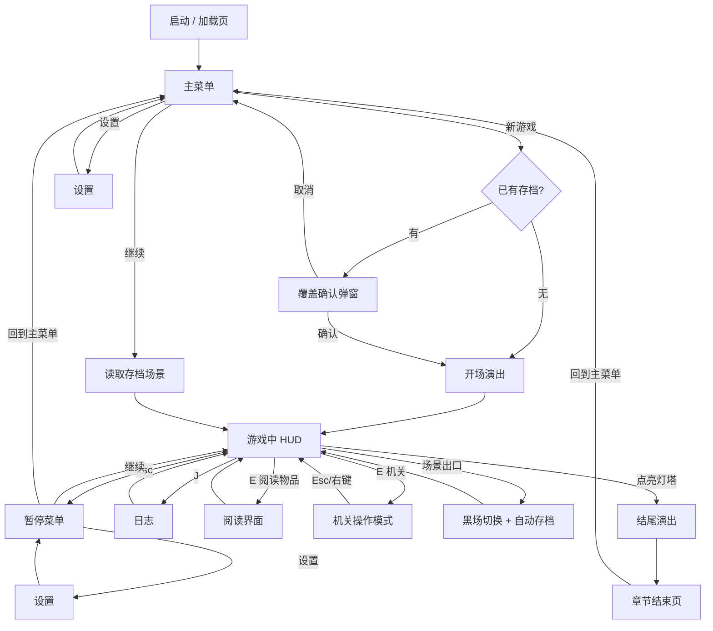

# 《雾灯》GDD：失落灯塔群岛

> **状态：已定稿（2026-10-29 用户确认）**
> 版本：v0.1 草稿 ｜ 作者：策划 ｜ 日期：2026-10-29
> 已定前提：方向 D（第三人称小场景探索解谜）；世界观「失落灯塔群岛」；**只做桌面浏览器**（键鼠，手柄列为后续项）；画质优先，整体氛围忧郁；Three.js + TypeScript + Vite。
> 工作名「雾灯」为占位，可改。
> 修订记录：2026-10-29 按制作人审阅意见修订（§10 设置/加载、§12 美术预算与暖色比例、§14 性能与画质分档）；并按老板答复写入：主角为 13 岁女孩「汐」、结局为父亲已不在且汐成为新守灯人（§5）、删除点击寻路（§3/§10/§15）、最低/推荐配置（§14）、保留三级提示；原 §16 待确认问题已全部答复，整节删除。按制作人裁定：S1 改冷色引导（湿铜钟高光 + 钟声），汐的风灯为暖光例外，谜题 5 光源改冷白色、点火瞬间才转暖，远景只有零星单只海鸟。画质与美术预算统一以 `art/style/style-guide.md` 为准。
>
> 修订记录：2026-10-29 新增 §5.5「世界观名词表」（制作人批准的补充，收录 text-ch1 中出现的人名、地名、物品名，后续章节以此为准；不改玩法）；同日按裁定修正 §7 谜题 4 的数字含义、§12 主角头身比和 LOD 面数，与 text-ch1、style-guide、拆单裁定保持一致。
>
> 修订记录：2026-10-30 §5.3 结尾演出补「可选：父亲回忆剪影叠在灯室玻璃上」（与 031/035 一致）；§5.2 补父亲回忆外形（按 031 美术样张）；§12.2 UI 按钮写明「只有主按钮带细描边」。
> 修订记录：2026-10-29 谜题 5 改为「点火口受光后由汐按 E 亲手点灯」（用户确认，制作人转达）：§7 谜题 5 新增「可点灯」状态与规则，同步 §5.3、§6 S3 动线、§8、§9、§12.2。
>
> 修订记录：2026-10-29 §3 按键表补 R（重置）；§7 谜题 2 写明退潮时按 R 放回浮台及提示「R 放回浮台」（制作人需求，规则以现有实现为准）。
>
> 修订记录：2026-10-29 制作人裁定：谜题 3 光路降到 y ≈ 0.85 m；S3 潮汐钟不缩小；楼梯竖直速度 0.55 m/s（§9）；S3 楼梯中段加带窗小平台，S3 改为自下而上只爬一趟（§6 S3 动线、§7 谜题 5 流程顺序与 R 只重置当前镜子）；谜题 2 解开后 R 停用（§3、§7）。
>
> 修订记录：2026-10-30 制作人裁定 15–17：§7 谜题 4 白石为地面透视拼合（正式版不叠数字贴片），观察模式为窗前固定第一人称眼位、FOV 30°，读不出 317 的条件改为「观察模式外任何可到达位置」。

> 修订记录：2026-10-29 制作人裁定（第二轮）：§9 S3 时长改为约 6–7 分钟、不加填充；谜题 5「没有油。」可选失败、R 只重置当前镜子、命中共鸣反馈标为已定；§6 S3 中段平台窗改为朝东、只见雾和海；按美术 rework-1029 坐标表写入导光镜 1/2 方位（各转 22°）和灯室楼梯口范围。

---

## 1. 概述与设计支柱

**一句话**：在雾与雨笼罩的群岛上，守灯人的孩子独自登上一座座熄灭的灯塔，借光的反射和潮水的涨落把它们重新点亮，也一点点读懂父亲为什么没有回来。

**体验关键词**：孤独、安静、留白、潮湿的冷、远处一点暖光。

**设计支柱**
1. **忧郁的氛围优先**：画面、声音、节奏都服务于「一个人、阴天、雾里」的感觉。低饱和冷色占画面绝大部分，暖光只在关键处出现，每一次点亮都是情绪的释放。
2. **看懂再动手**：谜题的答案藏在场景里，靠观察（包括自由转视角、站到特定位置去看）得出。不靠反应、不靠试错猜数字。
3. **两种核心机制，反复组合**：光线反射、潮汐涨落。每章只加少量新元素，靠组合产生深度，不堆系统。
4. **环境讲故事**：几乎没有大段对白。剧情放在信件、日志、遗物和场景细节里，字幕短句为主，留给玩家自己去想。
5. **小而精**：每个场景范围小、细节密，宁可少一个场景，也要保证每个角落都经得起镜头。

## 2. 核心玩法循环

```
抵达场景 → 自由探索、观察（遗物/日志/环境线索）
        → 发现障碍（门锁、断路、黑暗、积水）
        → 理解机制（镜子能转、潮汐钟能敲）
        → 操作机关解谜 → 开路/点亮
        → 短剧情片段（字幕、回忆、光的演出）
        → 进入下一场景 …… → 点亮本章灯塔 → 章节结束
```

- **单个谜题循环**（3-8 分钟）：观察 → 假设 → 操作 → 看到光/水的即时反馈 → 修正 → 解开。
- **章节循环**（20-30 分钟）：3 个场景，情绪从「孤独抵达」到「发现线索」再到「点亮的释放与更深的失落」。
- **长线循环**：一岛一章，每章一座灯塔、一段关于父亲和群岛的记忆、一个新的机制变体。

## 3. 操作方式（桌面键鼠）

默认模式：**鼠标锁定 + 自由视角**（点击游戏画面进入，Esc 退出锁定并暂停）。

| 操作 | 按键 | 说明 |
|---|---|---|
| 移动 | W A S D | 相对相机方向移动 |
| 慢走 / 小跑切换 | Shift（按住小跑） | 默认慢走，小跑用于赶路 |
| 转视角 | 鼠标移动 | 自由环绕，可设置灵敏度、Y 轴反转 |
| 交互 | E | 拾取/阅读/敲钟/进入机关操作/点灯（谜题 5） |
| 重置 | R | 机关操作中：当前机关回到初始状态；S1 谜题 2：退潮时在探索中按 R 把浮台放回原位（附近显示「R 放回浮台」）；谜题 2 解开后此功能停用 |
| 机关操作中旋转 | 鼠标左右（或 A/D） | 旋转镜子、拨盘等；按住 Shift 精调（慢速） |
| 机关操作中切换部件 | Q / E 或鼠标滚轮 | 在同一组机关的多个部件之间切换 |
| 退出机关 / 关闭阅读 | Esc 或 鼠标右键 | 回到自由探索 |
| 观察（拉近） | 按住鼠标右键 | 探索时视野收窄 + 景深，用于看远处线索 |
| 提示 | H | 打开当前谜题的提示（见 §7 提示设计） |
| 日志 | J | 查看已拾取的信件/日志 |
| 暂停 | Esc | 打开暂停菜单 |
| 跳过演出 | 按住 Space 1 秒 | 演出可跳过，首次观看也允许 |
| 推进字幕 | 鼠标左键 / Space | 字幕可手动推进，也会按时长自动推进 |

**手柄**：v0.1 不做，后续版本加（输入层按「动作」抽象，避免以后返工）。

## 4. 相机规则

| 项目 | 规则 / 初值 |
|---|---|
| 类型 | 第三人称环绕相机，跟随角色肩后偏右 0.4m |
| 距离 | 默认 4.0m，范围 2.5–6.0m（滚轮调节，机关操作中滚轮用于切换部件） |
| 俯仰角 | -35°（俯视）到 +55°（仰视） |
| 碰撞 | 球形射线检测，遇墙前拉，恢复平滑 0.25s；狭小室内自动缩到 2.0m |
| 视场角 | 55°；小跑时 +3°；观察模式（右键）收窄到 30° 并开景深 |
| 自动回正 | 默认关（自由视角是核心）；静止 8 秒后极慢地向「推荐构图」漂移，可在设置关闭 |
| 机关操作 | 按 E 进入机关后，相机 0.6s 平滑过渡到该机关的**预设机位**（能同时看到机关和光路/水位目标）；可在预设机位附近 ±20° 小范围转动 |
| 观察点 | 部分谜题有「观察点」（地面有不明显的标记，如磨亮的石板），站上去面朝正确方向时线索拼合，见谜题 4 |
| 演出 | 演出使用预设镜头轨道，结束后 0.8s 平滑交还玩家，保持演出前的朝向 |
| 场景切换 | 黑场淡入淡出 1.0s，进入新场景时有一个 3 秒的「建立镜头」再交还控制 |

**允许谜题利用视角**：可以要求玩家抬头看、转身看、站到特定位置看；但不要求精确到 1°，对准容差 ≥ 6°，并有视觉反馈（线索逐渐清晰）。

## 5. 世界观、主角与剧情

### 5.1 世界观

北方冷海上的一片群岛，常年阴天、浓雾、细雨。过去每座岛都有一座灯塔，由守灯人家族世代看守，灯光为往来的渔船和信船引路。

某个冬天起，雾越来越浓，灯塔一座接一座熄灭，船不再来，岛上的人陆续离开。群岛成了被遗忘的地方：空屋、晾到发白的渔网、停在钟面上的时间。

雾不只是天气。它像是遗忘本身，灯光照到的地方，雾会退开一些，被遗忘的东西也会短暂浮现。（这是贯穿全作的隐喻，v0.1 只轻点，不解释。）

### 5.2 主角

- **汐**（已定）：13 岁女孩，守灯人的孩子。话很少，穿宽大的藏青粗毛衣和父亲改小的灰蓝油布斗篷，提一盏黄铜风灯（外形细节以美术风格指南 §4 为准）。
- **父亲**：最后一位还在坚持的守灯人。三个月前驾小船去点亮外围的灯塔，再没回来。只在信件、日志和回忆里出现。回忆里的外形（031）：40 岁上下，高约 1.79 m，戴毛线帽，不留胡须；穿的就是后来改小给汐的那件灰蓝油布雨衣（带短披肩），保留同样的兜帽（放下搭在披肩后）、领型、口袋、扣位和接缝；那时还没褪色、比汐身上的深一档，没有补丁、不卷袖；父亲扣上穿（左襟压右襟），汐敞开穿。
- 主角动机：不是去「拯救世界」，只是想知道父亲去了哪里，以及把他没做完的事做完。全作的情感弧线是：从「找回父亲」慢慢变成「接过父亲的灯」。

### 5.3 第一章「归岸」剧情大纲

**一句话**：汐独自划船回到已经空无一人的家乡小岛，循着父亲留下的日志点亮了第一座灯塔，光照进雾里的那一刻，她看见远处另一座灯塔的轮廓，却没有任何回应。

| 段落 | 场景 | 内容 | 情绪 |
|---|---|---|---|
| 开场演出 | 海上 → S1 | 黄昏、细雨，小船在雾中靠近黑着的灯塔，雾号声。汐把船系在半淹的码头上，字幕：「爸爸说，灯不亮的时候，就自己回家。」 | 孤独、冷 |
| 第一幕 | S1 落潮滩 | 码头被涨潮淹没，汐找到父亲做的潮汐钟，学会让潮水退去/回涨，走上礁石小径 | 安静的好奇 |
| 第二幕 | S2 守灯人小屋 | 家里一切照旧，餐桌上两只杯子，一只倒扣着。读到父亲日志：雾一年比一年浓、外围灯塔熄灭、他决定出海；最后一页只有一句「如果灯一直没亮，就由你来点。」（伏笔，汐此时还不愿意读懂）。用镜子把风灯的光引进地窖，找到灯塔钥匙的线索 | 熟悉又空荡、心酸 |
| 第三幕 | S3 初望灯塔 | 登上灯塔，排出底层积水、调好镜组，把光送到点火口，亲手点亮主灯 | 压抑后的释放 |
| 结尾演出 | S3 灯室 → 远景 | 光束扫过海面，雾被推开一道口子，远处浮出第二座灯塔的黑色轮廓。汐等了很久，那边没有亮。她在日志空白页写下：「我会去找你。也会把它们一盏一盏点亮。」镜头拉远，只有一束光在雨里转。可选：汐眺望时，父亲的回忆剪影在灯室玻璃上短暂叠现（031 / 035，由制作人决定是否保留） | 释放后的更深失落，留悬念 |

### 5.4 长线剧情方向（留扩展空间）

- **结构**：一岛一章，预计 5–7 章，每章一座灯塔 + 一位旧守灯人的故事（以遗物、留言呈现）+ 一段父亲的足迹。
- **主线问题**：父亲去了哪里？灯塔为什么一座座熄灭？雾到底是什么？
- **主线答案（已定，逐章揭示，不提前说破）**：父亲已经不在了。他在点亮外围灯塔的途中遇难，汐沿着他的足迹一座座点灯，线索越来越明确地指向这个事实；最终章她找到父亲最后停留的灯塔和遗物，接受失去，成为群岛新的守灯人。
- **情绪节奏**：前期「寻找」（希望与不安并存）→ 中期「确认」（遗物、他人留言逐步证实父亲遇难）→ 后期「接受与接过」（汐开始用自己的方式守灯）。
- **候选章节主题**（仅方向，不承诺）：
  - 第二章「渔村」：被遗弃的渔村，引入「可移动镜子/棱镜分光」
  - 第三章「沉钟岛」：半沉在海里的教堂，潮汐 + 钟声
  - 第四章「冬岛」：结冰的海面，冰面反射与冰融
  - 中后期：灯塔之间光束互相传递，点亮的灯塔能影响下一座岛的雾
- **结局（已定）**：父亲已经不在，汐最终成为新的守灯人。基调忧郁但不绝望：群岛的灯重新连成一片，雾退开一些，被遗忘的东西被记住了，而汐留在了灯塔上。不做「找到父亲」的反转。
- **可扩展点**：收集品（旧照片、信）、外围小岛支线章节（隐藏结局如做，也只能是对同一结局的补充视角，不改变父亲已不在的事实），都留给 v0.2 以后。

### 5.5 世界观名词表

> 制作人批准的补充（2026-10-29），收录 `docs/gdd/text-ch1.md` 中出现的人名、地名和物品名。**后续章节的命名以本表为准**，新增名词也补进本表。本节不改玩法。

**人物**

| 名词 | 说明 | 首次出现 |
|---|---|---|
| 汐 | 13 岁女孩，守灯人的女儿，本作主角 | 开场演出 |
| 父亲 | 最后一位坚持的守灯人，三个月前出海点外围的灯后没有回来；只出现在文字和回忆里 | 开场演出（字幕「爸爸说……」） |
| 阿岩 | 岛上的邻居，随最后一班船离岛，带汐去了南岛 | S1 落潮滩（晾网架下的纸条） |
| 姑姑 | 汐的姑姑，住在南岛，汐离岛后寄住在她家 | S2 守灯人小屋（父亲日志第 2 页） |

**地点 / 灯塔**

| 名词 | 说明 | 首次出现 |
|---|---|---|
| 失落灯塔群岛 | 北方冷海上的群岛，常年阴天、浓雾、细雨，全作舞台 | 开场演出 |
| 南岛 | 群岛南边有人住的岛，岛上居民撤离时去了那里 | S2 守灯人小屋（父亲日志第 2 页） |
| 落潮滩 | 第一章家乡小岛的码头与礁石滩 | S1 |
| 守灯人小屋 | 汐和父亲的家，崖顶两层石屋，屋后有地窖 | S2 |
| 初望灯塔（初望灯） | 第一章的灯塔，家乡小岛的灯，本章点亮 | S2 守灯人小屋（父亲日志第 4 页；钥匙木牌） |
| 外礁灯 | 外海的一座灯塔，最早熄灭的一座 | S2 守灯人小屋（父亲日志第 1 页） |
| 北角灯 | 北边的一座灯塔，已熄灭 | S3 初望灯塔（值班簿） |
| 群岛航运所 | 管信船航线的机构，发布了停航告示 | S1 落潮滩（码头告示） |

> 进场景时的地名标题（文本 ID `ch1.s1/s2/s3.location.title`，BUG-005 程序补充）直接用本表的「落潮滩」「守灯人小屋」「初望灯塔」。旧 demo 里的「雾岬 · 第一座灯塔」不是正式地名，已从代码里去掉。

**物品**

| 名词 | 说明 | 首次出现 |
|---|---|---|
| 黄铜风灯 | 汐随身提的风灯，全章唯一常驻暖光，可放在书桌和灯台上 | 开场演出 |
| 潮汐钟 | 父亲做的铜钟 + 刻度石柱，敲一下切换涨潮/退潮 | S1 落潮滩 |
| 浮台 | 旧木筏，退潮可推、涨潮浮起 | S1 落潮滩 |
| 父亲日志 | 父亲的日记本，5 页正文，末页只写「出海那天」和一句话；结尾汐在空白页写字 | S2 守灯人小屋（二层书桌） |
| 灯塔钥匙 | 初望灯塔塔门的钥匙，挂着写「初望」的木牌 | S2 守灯人小屋（地窖） |
| 地窖草图 | 父亲画的窗框草图，写着「你小时候总在这里数船。」 | S2 守灯人小屋（地窖） |
| 光感锁 | 父亲做的锁，透镜受光才开 | S2 守灯人小屋（地窖门） |
| 值班簿 | 灯塔的值班记录，最后一条是「备船」 | S3 初望灯塔（塔门内） |
| 点火口 | 灯室里父亲设计的「借光点火」装置 | S3 初望灯塔（灯室） |

## 6. 第一章关卡设计（3 个场景）

> 尺度说明：1 单位 = 1 米。场景都是「小而密」的独立场景，边界用海、悬崖、浓雾自然收住，不放空气墙提示（空气墙存在但用雾掩盖）。

### S1 落潮滩（Ebb Shore）—— 谜题 1、2

**布局草图（文字）**：约 40m × 30m。
- 南侧：海面，小船停在半淹的旧木码头尽头（出生点）。
- 中部：一片礁石滩，涨潮时被淹，只露出几块黑石；退潮时露出一条礁石小径和搁浅的旧浮台（木筏）。
- 东侧：码头岸边的石台上有父亲做的**潮汐钟**（铜钟 + 刻着涨落刻度的石柱）。
- 北侧：悬崖，崖下有一道宽约 4m 的潮沟，对岸是通往 S2 的崖边石阶。
- 西侧：倒塌的渔具棚，晾网架，雾最浓（不可进入，营造纵深）。

**动线**：码头（出生）→ 沿码头走上岸 → 看到潮汐钟（远处钟面反着一点微光吸引视线）→ 敲钟退潮 → 走礁石小径到潮沟 → 发现过不去 → 把浮台推到潮沟 → 再敲钟涨潮让浮台浮起成为跳板 → 过沟 → 石阶 → 进入 S2。

**引导手法**
- 光与声：S1 没有环境暖光，用冷色引导。潮汐钟是湿铜材质，在灰暗场景里带一道明显的冷色高光，开场建立镜头就扫过它；玩家靠近时钟体随风轻响，敲响后的钟声在雾里回荡，成为声音上的引导。
- 声音：钟被风吹得偶尔轻响，声源在东侧。
- 构图：码头木板的方向直接指向岸边钟台。
- 环境：退潮后礁石小径上有一串旧脚印（父亲的），指向潮沟。

### S2 守灯人小屋（Keeper's House）—— 谜题 3、4

**布局草图（文字）**：约 30m × 25m，崖顶平台。
- 入口：S1 石阶上来，迎面是石墙小院。
- 中央：两层石砌小屋。一层厨房兼起居（可进入），二层卧室（可进入，看日志），地窖门在屋后，被**光感锁**封住（父亲做的机关：只有光照到锁上的透镜才会打开）。
- 东侧：小院里有两面立在石座上的**旧航标反射镜**（父亲修灯塔剩下的零件）。
- 西侧：崖边，散落着被雨冲刷的白色涂漆石块；远处海面上是 S3 灯塔（一直可见，作为目标）。
- 北侧：通往灯塔的崖径，被一道带三位拨盘锁的铁门挡住。

**动线**：进院 → 屋内探索（餐桌、倒扣的杯子、父亲日志，剧情主段落）→ 日志提到「地窖里有灯塔的东西」→ 屋后发现光感锁 → 回到院子，用风灯 + 两面镜子把光引到锁上（谜题 3）→ 地窖里找到灯塔钥匙和一页草图 → 草图提示「从窗口看崖边」→ 到二层窗口观察点，崖边白石拼成三个数字（谜题 4）→ 打开铁门 → 崖径 → 进入 S3。

**引导手法**
- 光：屋内窗户透出的暖光来自汐放在桌上的风灯，是院子里最亮的点；完成谜题 3 后地窖透出光，引向下一步。（汐的风灯是 style-guide 的例外：可以放下，窗口透出的暖光也算它的。）
- 叙事：日志文字直接给出下一步方向，但不给答案。
- 构图：二层窗户正对崖边，窗框本身就是取景框。
- 远景：灯塔始终在西北方地平线上，玩家知道终点在哪。

### S3 初望灯塔（First Watch Lighthouse）—— 谜题 5

**布局草图（文字）**：灯塔所在的小礁岛，崖径通过一段窄石桥连过来。
- 外部：约 20m × 20m 的礁岩，灯塔高约 25m，底座一侧被海浪拍打。
- 塔底层：机房，半淹在海水里（涨潮时水深没过阀门），有给灯油加压的手动阀门。
- 塔身：螺旋楼梯，每层一个小窗，楼梯井中空，可以从下往上看到灯室。楼梯中段（y ≈ 5 m，底层到第一面导光镜之间）有一个带窗的小平台：安静的景观窗，窗朝东（世界方位约 95°），只见雾和海：看不到石桥、S2 和守灯人小屋，也看不到结尾才出现的远处灯塔，不泄露 317；没有字幕、没有谜题，可以停下来看一会儿（制作人 2026-10-29 裁定，已定）。
- 中层：两面可转动的导光镜，安装在楼梯井内壁：导光镜 1 在 10 m 平台旁（θ140，镜心 y 10.6），导光镜 2 在 16 m 对侧平台旁（θ350，镜心 y 16.6），都离塔中心 1.3 m（S3 局部坐标，塔中心为原点，+Z 北、+X 西，θ 从 +X 逆时针；以美术 rework-1029 坐标表 `art/source/env/s3-layout.json` / `README-s3-layout.md` 为准）。为放下 y 5 带窗平台，两面镜子的安装方位各转了 22°（原 θ118 / θ328），灯室地面的楼梯口也跟着从 θ88–160 改为 θ110–182；光路三段仍都在楼梯井内，顺序不变。
- 顶层灯室：熄灭的主灯和巨大的菲涅尔透镜，旁边一个点火口需要被强光照射（父亲设计的「借光点火」）。

**动线**（自下而上，只需完整爬一趟，不要求来回跑（制作人 2026-10-29 裁定，已定））：过石桥 → 塔门（用 S2 的钥匙）→ 底层被淹，找不到路 → 塔门旁潮汐钟（与 S1 同款，复用 S1 的知识）→ 退潮，进底层拧开油阀 → 从底层抬头，看到两面导光镜和灯室点火口 → 在底层窗口把屋外雨云缝隙中漏下的一束冷白光引进楼梯井，光斑打到 10 m 处的第一面导光镜 → 上楼，经过中段窗台平台 → 10 m 平台调第一面导光镜，光斑打到 16 m 的第二面 → 上到 16 m 平台调第二面，光送进点火口，点火口微亮（仍是冷白）→ 上到灯室 → 汐拉下点火拉杆，亲手点灯（画面此刻才转暖）→ 结尾演出。每一步都能在当前位置看到光斑落在上方下一个目标上，所以不用回头确认。

**引导手法**
- 竖向构图：从底层抬头看楼梯井，能看到顶层灯室和点火口，暗示「光要往上走」。
- 光的预告：雨云里偶尔漏下一束冷白色的光照在塔外礁石上，暗示可利用。
- 知识复用：塔门旁的潮汐钟和 S1 是同一款（不缩小），不再教学。

## 7. 谜题设计（5 道）

**通用规则**
- 所有谜题状态可重置：机关界面里按 **R** 重置当前谜题（谜题 5 只重置当前这面镜子）（谜题 2 浮台没有机关界面，退潮时在探索中按 R 放回原位）；离开再进入场景也会重置未完成的谜题。
- 没有失败惩罚，没有死亡；最坏情况是「状态乱了」，重置即可。
- **三级提示**（按 H 或计时自动出现小图标，玩家主动点开才显示）：
  - 一级：方向性（「爸爸总说，潮水也是路。」）
  - 二级：指出关键物件（高亮关键物体轮廓 3 秒）
  - 三级：接近答案的步骤描述
- 提示触发时间见 §9 数值。提示文案以主角内心独白/父亲日志口吻写，不出戏。

### 谜题 1：退潮的路（S1，教学：潮汐）

- **机制**：潮汐钟有两个状态：涨潮 / 退潮。敲一次钟，场景水位在 6 秒内平滑切换。
- **初始状态**：涨潮，礁石小径被淹。
- **解法步骤**
  1. 走到潮汐钟前按 E，敲钟。
  2. 水位下降，露出礁石小径和搁浅的浮台。
  3. 沿小径走到潮沟边。
- **失败/重置**：无失败状态；可以随时再敲钟涨回去。涨潮时站在小径上的角色会被平滑传送回岸边（黑场 0.5s + 字幕「水太冷了。」），不算惩罚。
- **提示**：一级「钟上刻着两道线，一高一低。」/ 二级 高亮潮汐钟 / 三级「敲响它，看看海水会怎样。」
- **设计目的**：教会「我能改变水位，水位改变路」。几乎不可能卡住。

### 谜题 2：浮台渡沟（S1，潮汐 + 推动物体）

- **机制**：浮台退潮时搁浅在沙地上，可以推动（按住 E 推，沿固定轨道方向）；涨潮时浮起，停在当前位置，成为可以站上去的平台。
- **解法步骤**
  1. 退潮状态下，推浮台到潮沟边的石槽里（只有一个合法终点，有明显的石槽卡位）。
  2. 回到潮汐钟敲钟涨潮。
  3. 浮台浮起，正好与对岸石阶等高，从岸边跳板走上浮台再走到对岸（自动跨越，无需跳跃操作）。
- **失败/重置**：浮台没推到石槽就涨潮 → 浮台漂回原位（演出 2 秒），可重来；退潮时（潮汐不在变化中、浮台搁浅）按 R 把浮台放回原位，浮台附近显示「R 放回浮台」（`ui.prompt.reset_raft`，制作人需求 2026-10-29）；涨潮时 R 无效；谜题 2 解开后 R 不再放回浮台、也不显示提示（制作人 2026-10-29 裁定）。
- **提示**：一级「浮台在水里会浮起来吧？」/ 二级 高亮浮台和石槽 / 三级「先把浮台推到沟边，再让潮水涨回来。」
- **设计目的**：同一机制换个用法：退潮开路，涨潮也能开路。

### 谜题 3：借光开锁（S2，教学：光线反射）

- **机制**：
  - 光源：放在院中石台上的风灯（从屋里拿出来，E 拾取/放置，只能放在指定的两个灯台之一）。
  - 反射镜：两面立镜，每面绕竖轴旋转，**每次 15° 一档**（可精调到 7.5°），机关模式下鼠标左右转动。
  - 光路实时显示：光束是可见的暖黄体积光，碰到镜面按反射定律折返，打到墙面会留光斑。
  - 光感锁：锁上的透镜被光束持续照射 1.5 秒即打开。
- **解法步骤**
  1. 进屋拿风灯，放到院子东侧灯台（西侧灯台被晾衣架遮挡，放上去光照不出去，作为可试错的错误选项）。
  2. 转动第一面镜，把光束打向院墙角的第二面镜。
  3. 转动第二面镜，光束绕过屋角，照到屋后的光感锁。
  4. 锁上透镜亮起，地窖门打开（小演出：门缝透出灰尘里的光）。
- **失败/重置**：无失败；R 键让两面镜子回到初始角度。
- **提示**：一级「爸爸说过，光是会转弯的，只要给它一面镜子。」/ 二级 高亮两面镜子和锁 / 三级「把灯放在东边，先对准墙角那面镜子。」
- **设计目的**：教会镜子反射，光路可视让玩家边转边看，不用心算。

### 谜题 4：窗中的数字（S2，视角观察）

- **机制**：崖边散落的白漆石块从地面看是杂乱的，只有站在二层卧室窗前的观察点、透过窗框看向崖边时，才拼成三个数字（错觉拼图/透视画）。铁门三位拨盘锁（每位 0–9）。
- **线索链**：地窖里父亲的草图画着一个窗框，旁边写「你小时候总在这里数船。」→ 玩家想到二层窗户。
- **解法步骤**
  1. 走到二层窗前（地板磨亮的位置），面朝崖边。
  2. 按住右键进入观察：镜头切到窗前固定的第一人称眼位（FOV 30°，不随站位变化），用鼠标把视线对准崖边，白石逐渐拼合成「3 1 7」（对准容差 6°，越接近越清晰，完全对上时有一声轻微的风铃声）；松开右键回到第三人称。
  - 白石是地面上的透视拼合：画面里只有石头本身被提亮/描边，没有额外叠加的数字；观察模式外，从任何能走到的位置都读不出 317（制作人裁定 2026-10-30）。
  3. 到北侧铁门按 E，拨盘输入 317，门开。
- **失败/重置**：输错无惩罚，拨盘可以随便试（但 1000 种组合，实际上靠观察）。
- **提示**：一级「小时候我在哪里数船？」/ 二级 高亮二层窗户 / 三级「站在卧室窗前，往崖边看。」
- **数字含义**：317 是父亲定下的密码，第一章不解释它的来历，日志里也不出现任何能提前对上的日期（制作人裁定，避免提前泄露答案）。
- **设计目的**：用起自由视角，让「观察」本身成为解谜手段，也承载剧情。

### 谜题 5：灯塔点火（S3，潮汐 + 反射组合，本章收束）

> **用户 2026-10-29 确认**（制作人转达）：点火口受光后不再自动点燃，改为由汐按 E 亲手点灯（`ui.prompt.ignite`「E 点灯」）。

- **机制**：
  - 塔门旁的潮汐钟控制塔底水位（复用谜题 1，与 S1 同款同尺寸）。
  - 底层油阀：退潮时才能接触，按住 E 旋转 2 秒打开。
  - 光源：雨云缝隙中漏下的冷白色天光（不是暖色阳光，整个光路在点火前都保持冷白），周期性出现（每 40 秒一次，持续 25 秒；**油阀打开后改为常亮**，避免等待挫败）。
  - 底层窗口有一面可调镜（绕竖轴 + 俯仰轴各一档 15°），把窗外光送进楼梯井向上。
  - 中层两面导光镜（各绕一个轴旋转），把光一路送到顶层点火口。
  - 点火口：父亲做的「借光点火」装置，旁边有一根点火拉杆。光聚到点火口还不够，要汐亲手拉下拉杆，灯才会点着。
- **解法步骤**
  1. 敲塔门旁的潮汐钟退潮，进入底层，打开油阀（灯有了油，但还没点火）。字幕：「还需要火……或者光。」
  2. 调底层窗口镜，把窗外光打进楼梯井、向上照到中层第一面导光镜。
  3. 爬上中层，调第一面导光镜打向第二面。
  4. 调第二面导光镜，对准顶层点火口。
  5. 点火口连续受光 **1.0 秒**（油阀已开）→ 进入「可点灯」状态：点火口冷白微亮，有轻微嗡鸣，仍是冷色。
  6. 汐走进灯室、站在互动范围内时显示「E 点灯」；按 E → 汐拉下点火拉杆 → 主灯点燃，这一刻光束和画面才由冷转暖（暖色占比可放宽到约 30%）→ 结尾演出。
- **「可点灯」状态规则**：
  - 光路断开有 **0.3 秒**容差（防抖）：断开不超过 0.3 秒不算断；超过就退出可点灯状态，微光和提示消失，重新受光要再连续 1.0 秒。
  - 按 E 时以当时的状态为准：处于可点灯状态（含 0.3 秒容差内）才生效。
  - 按 E 后锁定输入，播放汐拉杆的动作，再接点灯高潮和结尾演出；按 E 只能触发一次。
  - 可点灯状态持续 20 秒玩家没按：**不会自动点灯**，只把嗡鸣和微光加强一次（脉冲），之后保持原样等待。
- **顺序容错**：先调镜子后开油阀也可以；光照到点火口但没开油阀时，点火口只发红光、不进入可点灯状态，字幕提示「没有油。」；之后打开油阀，光还在点火口上的话，从开阀起再连续 1.0 秒进入可点灯状态。
- **流程顺序**（制作人 2026-10-29 裁定）：整个 S3 自下而上推进，按上面 1→6 做只需从底层完整爬一趟到灯室。底层两件事（油阀、窗口镜）都在出发前做完；之后每面镜子都在自己的平台上调，调好时光斑清楚落在上方的下一个目标上。
- **失败/重置**：涨潮时人在底层 → 平滑送回塔门口（同谜题 1）；机关模式里按 R 只重置**当前这面镜子**（不会把楼下的镜子也复位，避免被迫下楼（制作人 2026-10-29 裁定，已定））；油阀状态不重置。玩家跳过油阀直接上楼时，光照到点火口会发红光并出现「没有油。」，这时需要下楼补开油阀——保留为可选失败，这是唯一需要折返的情况（不在正常流程里，不加硬性拦截）（制作人 2026-10-29 裁定，已定）。
- **命中反馈**（制作人 2026-10-29 裁定，已定）：光斑落到下一面镜子上时，那面镜子轻微亮一下 + 一声细微的玻璃共鸣，让玩家在当前平台就能确认这一步做对了。
- **提示**：一级「这里的光，要从下面一直走到上面。」/ 二级 高亮油阀、底层镜、点火口（按当前进度只高亮下一步）/ 三级 描述当前下一步。处于可点灯状态时请求提示，直接给「光已经到了。剩下的那一下，要我自己来。」（`ch1.hint.p5.ignite.l3`），不写按键名。
- **设计目的**：把本章两个机制组合起来，难度最高，但每一步都有明确视觉反馈。

## 8. 谜题机制库

| 机制 | 说明 | v0.1 | 后续 |
|---|---|---|---|
| 潮汐钟（二档水位） | 敲钟切换涨/退潮，影响通路、浮物 | ✅ | 三档水位、多座钟分区控制 |
| 浮物 | 退潮可推，涨潮浮起成平台 | ✅ | 浮物载着镜子随水位升降（组合反射） |
| 旋转反射镜 | 绕单轴/双轴旋转，光路实时可见 | ✅ | 可搬运的镜子 |
| 光感锁 / 点火口 | 光感锁：被光持续照射后触发；点火口：受光后进入「可点灯」状态，由玩家按 E 点燃 | ✅ | 需要特定颜色光才触发 |
| 视角观察（透视拼合） | 站在观察点、对准方向，线索拼合 | ✅ | 透过灯塔透镜看到隐藏信息 |
| 拨盘锁 | 输入从环境中观察到的密码 | ✅ | — |
| 间歇自然光 | 云缝冷白天光/月光周期出现 | ✅（简化版） | 昼夜/天气变化作为机制 |
| 棱镜分光 | 一束光分成多束 / 染色 | ❌ | 第二章候选 |
| 彩色滤镜 | 改变光的颜色以匹配锁 | ❌ | 后续 |
| 潮汐定时 | 潮水按时间自动涨落，需要卡时机 | ❌ | 后续（注意别变成反应考验） |
| 灯塔光束扫射 | 点亮的灯塔光束旋转，照到的地方雾散/物体显形 | ❌ | 中后期主线机制 |
| 雾的显形 | 光照到的地方出现被遗忘的物体/路 | ❌（仅结尾演出暗示） | 中后期主线机制 |
| 冰面反射 / 冰融 | 冰作为镜面，被光照融化 | ❌ | 冬岛章节 |

## 9. 数值（初值，灰盒阶段调）

| 项目 | 初值 | 备注 |
|---|---|---|
| 慢走速度 | 1.6 m/s | 默认，配合忧郁节奏 |
| 小跑速度 | 3.2 m/s | 按住 Shift |
| 转身速度 | 540°/s | 角色朝向插值 |
| 交互距离 | 1.8 m | 且需面向物体 ±60° |
| 交互提示出现距离 | 3.5 m | 物体旁出现冷色交互提示小图标（`#A9BCC4`，style-guide §2） |
| 楼梯移动速度 | 竖直约 0.55 m/s | 台阶 0.2 m、踏面 0.26 m（水平约 0.715 m/s）；S3 底层到灯室单程约 40 s；楼梯上不分慢走/小跑（制作人 2026-10-29 裁定） |
| 潮汐切换时长 | 6 s | 水位平滑过渡，期间钟不可再敲 |
| 水位差 | 1.6 m | 涨潮/退潮高差 |
| 浮台推动速度 | 0.8 m/s | 按住 E |
| 镜子旋转档位 | 15°（精调 7.5°） | 每档有轻微咔哒声 |
| 光感锁触发时长 | 1.5 s | 点火口：连续受光 1.0 s 进入可点灯状态，断光容差 0.3 s；可点灯 20 s 未按时提醒脉冲一次（用户 2026-10-29 确认） |
| 光束最大反射次数 | 4 | 超过不再计算 |
| 视角观察容差 | 6° | 偏差 12° 内逐渐清晰 |
| 云缝光周期 | 40 s 周期 / 25 s 持续 | 开阀后常亮 |
| 一级提示可用 | 进入谜题区域后 3 分钟 | 只出现小图标，不弹出文字 |
| 二级提示可用 | 一级后再 3 分钟 | |
| 三级提示可用 | 二级后再 4 分钟 | |
| 字幕自动推进 | 每字 0.12 s，最短 2.0 s | 可手动推进 |
| 场景切换黑场 | 1.0 s | |
| 目标单章时长 | 20–30 分钟（下限 15） | S1 约 6 分钟、S2 约 10 分钟、S3 约 6–7 分钟（不含演出，不加填充（制作人 2026-10-29 裁定，已定）），加演出约 4 分钟，合计约 26–27 分钟 |

## 10. UI 流程



**界面元素**

| 界面 | 元素 |
|---|---|
| 启动/加载页 | 雾中灯塔剪影插画、加载进度（细线 + 百分比）、首次加载提示「建议佩戴耳机」。分两段：启动只加载主菜单包（≤15 MB，3 秒内出现主菜单）；点「新游戏/继续」后加载首场景包（≤150 MB），加载页显示进度 |
| 主菜单 | 背景：轻量的雨中灯塔远景（灯塔剪影 + 雾墙贴片 + 雨粒子，缓慢推镜，资源计入主菜单包 ≤15 MB；超预算则改用静态插画）；标题字；按钮：继续（无存档时隐藏）、新游戏、设置、制作名单；版本号 |
| 设置 | 画质档位（极致/高/标准，默认极致，参数见 style-guide §8）；鼠标灵敏度、Y 轴反转；主音量/音乐/音效；字幕大小（小/中/大）；显示帧率开关；恢复默认 |
| 游戏中 HUD | 极简：默认无常驻 UI。交互提示（物体旁小图标 + 「E 阅读」）；提示可用时右下角一个小风灯图标；字幕区（底部居中，浅阴影、不加底框，与 style-guide §6 一致）；拾取日志时左下角短暂出现「日志已更新」 |
| 机关操作模式 | 底部按键提示条（鼠标 旋转 / Shift 精调 / Q·E 切换 / R 重置 / Esc 退出）；当前部件微弱描边 |
| 阅读界面 | 纸张特写（信件/日志页面贴图 + 可选文字版叠加），翻页箭头，Esc 关闭 |
| 日志 | 已拾取的信件和日志条目列表，按章节分组；当前目标一句话（父亲日志口吻） |
| 提示弹窗 | 按 H 打开，显示已解锁的提示层级，未解锁的显示「再等等，四处看看」 |
| 暂停菜单 | 游戏画面模糊 + 暗化；继续、设置、回到主菜单（提示「将回到最近的场景开头」） |
| 章节结束页 | 章节名「第一章 · 归岸」、一张点亮的灯塔插画、本章用时、使用提示次数（只陈述不评分）、「未完待续」、回到主菜单 |

## 11. 存档规则

- **存储**：浏览器 localStorage（键名 `foglight.save.v1`），单存档位。
- **存档时机**（自动，无手动存档）：
  - 开场演出结束、进入 S1 时
  - 每次进入新场景时（黑场切换中）
  - 点亮灯塔、进入章节结束页时
- **存档内容**：存档版本号、章节 ID、场景 ID、已读日志/信件 ID 列表、累计游玩时间、提示使用次数、设置（设置单独存键 `foglight.settings.v1`，不随新游戏清除）。
- **读档**：「继续」回到存档场景的入口，场景内谜题全部为初始状态。（每个场景只有 1–2 道短谜题，重做成本低；v0.1 不做谜题级存档。）
- **异常处理**：存档版本不匹配或解析失败 → 提示「存档无法读取」，只提供新游戏，不崩溃。浏览器隐私模式无法写入时，提示进度不会保存。
- **章节完成后**：存档标记第一章完成，「继续」进入章节结束页，可重新开始。

## 12. 美术需求概述

### 12.1 风格

- **三渲二半写实**：角色和道具用卡通着色（色阶 ramp + 柔和边缘光 + 可选细描边），比例写实（非 Q 版）；环境半写实，手绘质感贴图 + PBR 粗糙度/法线，靠光照和大气出层次。
- **色彩**：低饱和冷色为主（灰蓝、铅灰、雾白、深墨绿），暖黄橙只出现在灯塔、风灯和被点亮的光束上，同屏暖色面积平时 ≤ 15%，点灯高潮那几秒可放宽到约 30%（与 style-guide §0 一致）。
- **天气与时间**：S1 黄昏 + 细雨；S2 阴天 + 雨停后的湿润（唯一暖光是汐放在屋里的风灯）；S3 暴雨前的铅色天空，点亮后雨里的光束。
- **构图**：大量留白，雾吃掉远景，一个场景只有一个视觉焦点。
- **参考方向**：北欧海岸、苏格兰赫布里底群岛、阴天的老照片色调。

### 12.2 资源清单

| 类别 | 内容 | 预算建议 |
|---|---|---|
| 主角 | 汐（13 岁女孩，约 6 头身，以 style-guide §4 为准）：藏青粗毛衣、灰蓝油布斗篷、黄铜风灯；动画：待机（含湿冷时的小动作）、慢走、小跑、推、敲钟、拾取、转动机关、拉点火拉杆（点灯）、阅读、坐下（演出用） | 面数与贴图以 style-guide §8 为准：主角三角面 lod0 ≤120k（极致）/ lod1 ≤50k（高、标准共用）/ lod2 ≤25k（制作人拆单裁定）；角色贴图上限 4096 / 2048 / 2048 |
| 父亲 | 只在回忆演出中出现的剪影/半透明形象 | 按 NPC 预算（style-guide §8）：极致 60k / 高 40k / 标准 25k |
| S1 落潮滩 | 码头、礁石组（可复用模块）、潮汐钟、浮台、渔具棚、晾网架、小船、悬崖、潮沟、石阶 | 场景可见总面数以 style-guide §8 为准（极致 6M / 高 3.5M / 标准 1.5M） |
| S2 守灯人小屋 | 两层石屋（室内可进入，餐桌、杯子、床、书桌、窗户）、地窖、两面立镜 + 石座、光感锁、拨盘铁门、白漆石块组（透视拼合）、崖径 | 同上；室内道具要经得起近景 |
| S3 初望灯塔 | 灯塔外观、塔底机房（油阀、水）、螺旋楼梯、导光镜 ×3、灯室、菲涅尔透镜（需要折射/高光质感）、点火口（带点火拉杆）、石桥 | 同上 |
| 通用 | 海面（涨退潮）、雨、雾、湿地面材质、零星单只海鸟（远景，不做鸟群）、天空（程序化渐变 + 手绘云层，按时段预设 overcast-dusk / rain-night / after-lit，见 style-guide §3） | — |
| 道具 | 风灯、日志、信件 ×6–8 页、钥匙、草图 | 重点道具贴图上限按 style-guide §8（4096 / 2048 / 2048），普通道具按环境贴图上限（2048 / 2048 / 1024） |
| UI | 标题字、按钮（只有主按钮带细描边，其余为无边框文字按钮）、图标（交互、提示风灯、日志）、纸张贴图、章节结束插画、加载插画 | 矢量/2x 位图 |
| 特效 | 体积光束、镜面反射光斑、水花、雨滴溅落、雾流动、灯塔点亮光晕 | — |

**通用规范**：以 style-guide §7.6、§8、§9 为准。glTF/GLB（Meshopt 压缩）+ KTX2 贴图；同类岩石、木板、草用 InstancedMesh/BatchedMesh 复用；每个模型做 LOD0–LOD2（每级面数减半），远景用 impostor；draw call 上限按 §8 分档（极致 2000 / 高 1200 / 标准 600）。

## 13. 音效与配乐需求概述

- **配乐**：极简、留白。钢琴 + 大提琴 + 环境氛围音色（铺底长音），每个场景一首循环曲（2–3 分钟，安静、几乎没有旋律高潮）；结尾演出一首完整曲目（点亮时第一次出现完整旋律，随后回落）。主菜单一首。共约 5 首。
- **环境音（重点）**：雨（细雨/大雨/屋檐滴水/雨打玻璃）、海浪（远/近/拍岸）、风、远处雾号、木码头吱呀、室内的钟摆、海鸟（偶尔、远处单只，不做鸟群）。环境音分层，按场景和位置混合（3D 定位）。
- **交互音效**：潮汐钟（低沉、带长余韵）、水位变化（涌动/退去）、推浮台、镜子转动咔哒、光束接通（细微的玻璃共鸣）、锁打开、拨盘、翻纸、脚步（沙/石/木/室内/湿地面各一套）。
- **UI 音效**：轻、少；按钮悬停几乎无声，确认用一声很轻的木/纸声。
- **无配音**（v0.1 只有字幕）。
- 混音原则：大部分时间音乐很轻或没有，让环境音撑起孤独感；点亮灯塔是全章唯一的音乐高点。

## 14. 性能预算（只做桌面）

> **画质分档、面数、draw call、贴图、阴影、雾、后处理等参数，以 `art/style/style-guide.md` §8 为准**，本节只摘要关键数，有出入时以指南为准。

**基准**（已定）：RTX 3060 级显卡，**1440p，极致档 60fps**（帧时间 16.6 ms）。高档、标准档用于适配较弱的电脑。

**对外配置要求**（已定）
- **最低配置**：GTX 1650 级显卡（目标为标准档可流畅游玩）。
- **推荐配置**：RTX 3060 级显卡（极致档，1440p 60fps）。
- CPU、内存、浏览器版本要求由程序在框架阶段实测后补充。

**三档关键数（摘自 style-guide §8；「视距」一行为制作人 2026-10-29 裁定，见任务单 009）**

| 项目 | 极致 `ultra`（默认） | 高 `high` | 标准 `standard`（兜底） |
|---|---|---|---|
| 渲染分辨率缩放 / 最大像素比 | 1.0 / 2.0 | 1.0 / 1.5 | 0.8 / 1.0 |
| 主角 / NPC 三角面 | 120k / 60k | 50k / 40k | 50k / 25k |
| 可见场景总面数 | 6M | 3.5M | 1.5M |
| draw call 上限 | 2000 | 1200 | 600 |
| 贴图上限（角色/重点道具，普通环境） | 4096，2048 | 2048，2048 | 2048，1024 |
| 雾 | 体积雾（froxel 160×90×128） | 体积雾（半分辨率 froxel 80×45×64） | 假体积贴片 |
| 光束 | raymarch 64 步 | raymarch 32 步，半分辨率 | 加法锥形网格 + 公告板 |
| 阴影 | CSM 4 级 4096 + PCSS + 接触阴影；点光阴影 2 盏 | CSM 3 级 2048 + PCF；点光阴影 1 盏 | CSM 2 级 2048 + PCF；点光阴影 1 盏（512） |
| AO / 反射 | GTAO 全分辨率 / SSR + 平面反射 1.0× | GTAO 半分辨率 / 平面反射 0.5× + 湿地面 SSR 半分辨率 | 烘焙 AO / 反射探针 + 平面反射 0.25× |
| 景深 / 抗锯齿 | bokeh / TAA | 高斯（只在过场）/ SMAA | 关 / SMAA |
| 雨粒子 | 30k + 雨圈 + 镜头水滴 | 15k + 雨圈 | 6k + 雨圈 |
| 视距（`viewDistance`，相机远裁剪面） | 600 m | 400 m | 250 m |

完整参数（描边、雾贴片数、bloom、胶片颗粒、LOD 距离、impostor 距离、草密度等）见指南 §8，程序直接按其键名写入 `game/src/config/quality.ts`。

**本 GDD 对玩法相关的补充要求**（不改变上表数字）
- 谜题光路（镜子反射的光束）在三档都必须清晰可见：标准档用假体积光束，但光束的路径、落点光斑和触发反馈与极致档一致，不能因降档影响解谜。
- 谜题 4 的视角观察依赖远处白石的可辨认度：崖边白石在三档都要在 LOD0 距离内（标准档 LOD0 为 25 m，关卡布局需保证观察点到白石 ≤ 25 m，或白石单独设为不降级物件）。
- 涨退潮的水面、水位湿痕线和光路是动态的，三档都实时计算；静态环境走烘焙光照贴图 + AO（见指南 §3.1）。
- 帧时间分配（极致档，摘自指南 §8）：几何和阴影 ≤ 7 ms，体积雾和光 ≤ 3 ms，反射 ≤ 2 ms，其余后处理 ≤ 3 ms，余量 1.6 ms。

**渲染器**：默认 WebGL2，检测到 WebGPU 时走 `WebGPURenderer`（见指南 §7.1），具体由程序在框架阶段确认。

**自动画质**（已裁定，制作人 2026-10-29）：首次启动后第一次进入 S1 时跑一次，从极致档开始，每轮测 **3 秒**平均帧率，低于 50 降一档后重测，最多 3 轮（共约 9 秒）、最多连降两档，第 3 轮只测标准档并记录、不再下降；第 1 轮在开场演出内完成，降档后的重测可在玩家可操作后继续；第 1 轮完成前跳过开场演出时，保留 3 秒不可跳过的 S1 建立镜头跑第 1 轮，镜头播完停在最后一帧，最多再等 5 秒后交还控制；切档不能有可见黑帧；设置里可手动切换（细则见任务单 009、035）。

**加载**（已定）
- 主菜单包 ≤ 15 MB，3 秒内出现主菜单。
- 首场景包（S1 的模型 + 贴图 + 字体）≤ 150 MB；能先进游戏的部分尽量压小。
- S2、S3 在游玩时后台流式预加载，切换场景时不应再出现长时间加载（黑场 1.0 s 内完成；未加载完则在黑场中显示细线进度）。
- 字体按章节子集化，转 WOFF2。

## 15. v0.1 不做的内容

- 手机/平板触屏支持、手机性能适配（已决定只做桌面）
- 手柄支持（输入层预留，后续版本做）
- 点击地面寻路（已决定不做，移动只用 WASD）
- 第二章及以后的任何内容；章节选择
- 收集品、成就、隐藏结局
- 配音、多语言（v0.1 只有简体中文字幕）
- 谜题级存档、多存档位、云存档
- 棱镜分光、彩色滤镜、潮汐定时、灯塔光束扫射、雾的显形等后续机制
- 跳跃、攀爬、游泳等动作系统（角色只能走、小跑，跨越由交互点自动完成）
- 照相模式、自定义按键（自定义按键可视进度加进设置）
- 任何联网功能
