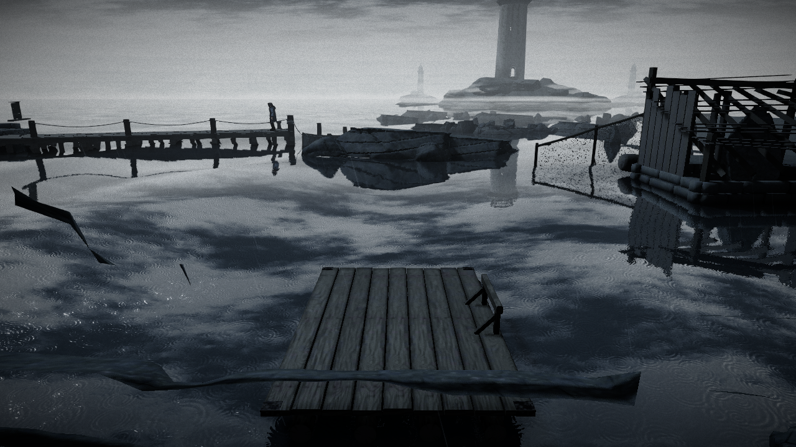
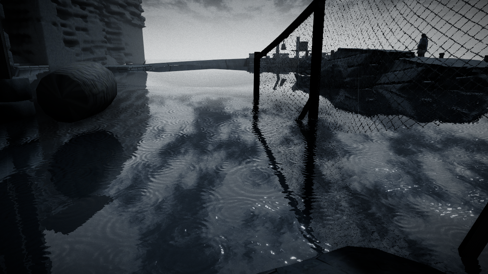
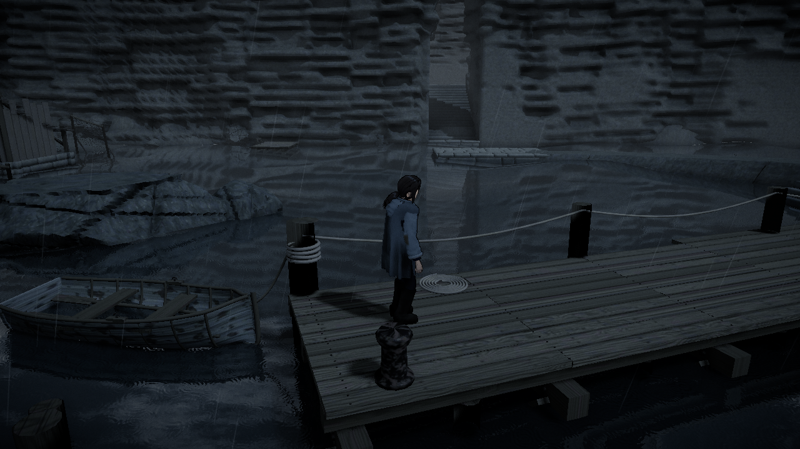

# v0.1 性能报告

> 自动生成：2026/11/1 00:37:36（UTC+7），代码 bad3643 037 verify-memory：JS 堆拆成对象堆和 V8 代码区（堆快照里 type=code 的节点），±10% 比对象堆，总堆照记；perf-report 内存表跟着显示。依据：首进 S1 → 通关再进 S1 的堆快照差 1.84 MB，其中 ~1.6 MB 是 S2/S3 首次执行留下的字节码 / JIT 码 / 反馈向量，游戏对象差 ~0.2 MB；多绕圈不再涨。生成脚本 game/scripts/gen-perf-report.mjs，原始数据 docs/releases/perf/*.json。
> box 上的数字来自无头 Chrome + swiftshader（软件渲染），只用于三角面 / draw call / 贴图 / 包体 / 加载 / 内存这些与 GPU 无关的计数；帧率不在这里量。

## 1 帧率（由用户 M8 实机填写）

> **由用户 M8 实机填写（基准 RTX 3060 级 1440p 极致档 60fps；最低 GTX 1650 级标准档）**。开发期 F3 面板看到的帧率只作自测参考，不写进本栏。

| 机器 | 分辨率 | 档位 | 场景 / 机位 | FPS | 1% low | 帧时间 (ms) | 浏览器 | 备注 |
|---|---|---|---|---|---|---|---|---|
| RTX 3060 级 | 2560×1440 | 极致 | S1 最差机位 |  |  |  |  |  |
| RTX 3060 级 | 2560×1440 | 极致 | S2 最差机位 |  |  |  |  |  |
| RTX 3060 级 | 2560×1440 | 极致 | S3 最差机位 |  |  |  |  |  |
| RTX 3060 级 | 2560×1440 | 高 | S1 最差机位 |  |  |  |  |  |
| RTX 3060 级 | 2560×1440 | 高 | S2 最差机位 |  |  |  |  |  |
| RTX 3060 级 | 2560×1440 | 高 | S3 最差机位 |  |  |  |  |  |
| GTX 1650 级 | 1920×1080 | 标准 | S1 最差机位 |  |  |  |  |  |
| GTX 1650 级 | 1920×1080 | 标准 | S2 最差机位 |  |  |  |  |  |
| GTX 1650 级 | 1920×1080 | 标准 | S3 最差机位 |  |  |  |  |  |

## 2 预算校验（verify-budget）

三档预算（style-guide §8，不改参数）：

| 档 | 可见面数 | draw call | 主角 | NPC | 贴图（角色道具 / 环境） |
|---|---|---|---|---|---|
| 极致 | 6.00 M | 2000 | 120.0 k | 60.0 k | 4096 / 2048 |
| 高 | 3.50 M | 1200 | 50.0 k | 40.0 k | 2048 / 2048 |
| 标准 | 1.50 M | 600 | 50.0 k | 25.0 k | 2048 / 1024 |

跑于 2026/11/1 00:25:56（UTC+7），视口 640×360；「主 pass」= 场景相机那一次 renderer.render 扣掉阴影；「整帧」含阴影、水面反射、后处理法线 / 深度 pass（只列不判）。结论：**全部通过**（另有已知警告 7 项，见下「已知项」）。 M7 收尾复跑（2026/11/1 06:1x UTC+7）：**全部通过**，已知警告 4 项（S1 标准档主 pass 面数 2.20–2.56 M，均 ≤ 2.7 M 上限），明细在 perf/verify-budget.json、perf/check-release.log。batch26 收尾复跑（2026/11/1 11:15–11:27 UTC+7，代码 32455f3）：**全部通过**，已知警告同样 4 项（数值不变）。

| 场景 | 档 | 机位 | 主 pass 面数 | 主 pass call | 整帧面数 | 整帧 call | 阴影面数 / call | 角色当前 LOD | 结果 |
|---|---|---|---|---|---|---|---|---|---|
| S1 | 极致 | s1-raft-back | 3.39 M | 89 | 10.09 M | 287 | 3.18 M / 41 | xi 0 | 过 |
| S1 | 极致 | s1-neighbor-note | 3.37 M | 51 | 10.03 M | 175 | 3.25 M / 37 | xi 0 | 过 |
| S1 | 极致 | s1-spawn-north | 3.37 M | 48 | 10.02 M | 169 | 3.25 M / 37 | xi 0 | 过 |
| S1 | 极致 | s1-opening | 3.35 M | 77 | 10.02 M | 263 | 3.18 M / 41 | xi 0 | 过 |
| S1 | 高 | s1-raft-back | 2.86 M | 89 | 8.60 M | 286 | 2.79 M / 41 | xi 1 | 过 |
| S1 | 高 | s1-neighbor-note | 2.86 M | 55 | 8.60 M | 186 | 2.84 M / 41 | xi 1 | 过 |
| S1 | 高 | s1-spawn-north | 3.06 M | 52 | 9.20 M | 180 | 3.04 M / 41 | xi 1 | 过 |
| S1 | 高 | s1-opening | 2.83 M | 77 | 8.53 M | 262 | 2.79 M / 41 | xi 1 | 过 |
| S1 | 标准 | s1-raft-back | 2.20 M | 93 | 6.36 M | 232 | 2.04 M / 43 | xi 1 | 已知项 |
| S1 | 标准 | s1-neighbor-note | 2.40 M | 55 | 7.02 M | 153 | 2.30 M / 39 | xi 1 | 已知项 |
| S1 | 标准 | s1-spawn-north | 2.56 M | 52 | 7.48 M | 147 | 2.45 M / 39 | xi 1 | 已知项 |
| S1 | 标准 | s1-opening | 2.33 M | 80 | 6.76 M | 209 | 2.20 M / 42 | xi 1 | 已知项 |
| S2 | 极致 | s2-white-stone-5 | 761.2 k | 97 | 1.98 M | 251 | 591.4 k / 97 | xi 0 | 过 |
| S2 | 极致 | s2-white-stone-1 | 757.6 k | 86 | 1.97 M | 240 | 591.4 k / 97 | xi 0 | 过 |
| S2 | 极致 | s2-dial-gate | 750.5 k | 75 | 1.91 M | 228 | 591.4 k / 97 | xi 0 | 过 |
| S2 | 高 | s2-white-stone-5 | 588.5 k | 97 | 1.53 M | 250 | 520.0 k / 97 | xi 1 | 过 |
| S2 | 高 | s2-white-stone-1 | 584.9 k | 86 | 1.53 M | 239 | 520.0 k / 97 | xi 1 | 过 |
| S2 | 高 | s2-dial-gate | 577.8 k | 75 | 1.49 M | 227 | 520.0 k / 97 | xi 1 | 过 |
| S2 | 标准 | s2-white-stone-5 | 415.4 k | 97 | 870.0 k | 207 | 243.3 k / 83 | xi 1 | 过 |
| S2 | 标准 | s2-white-stone-1 | 469.4 k | 86 | 981.5 k | 196 | 300.8 k / 83 | xi 1 | 过 |
| S2 | 标准 | s2-dial-gate | 547.8 k | 75 | 1.12 M | 184 | 386.3 k / 83 | xi 1 | 过 |
| S3 | 极致 | s3-spawn-south | 699.5 k | 44 | 1.80 M | 157 | 433.6 k / 23 | father 0，xi 0 | 过 |
| S3 | 极致 | s3-oil-valve | 696.3 k | 40 | 1.76 M | 135 | 433.6 k / 23 | father 0，xi 0 | 过 |
| S3 | 极致 | s3-logbook | 690.2 k | 34 | 1.73 M | 118 | 433.6 k / 23 | father 0，xi 0 | 过 |
| S3 | 高 | s3-spawn-south | 526.8 k | 44 | 1.38 M | 156 | 362.2 k / 23 | father 0，xi 1 | 过 |
| S3 | 高 | s3-oil-valve | 523.6 k | 40 | 1.34 M | 134 | 362.2 k / 23 | father 0，xi 1 | 过 |
| S3 | 高 | s3-logbook | 517.5 k | 34 | 1.31 M | 117 | 362.2 k / 23 | father 0，xi 1 | 过 |
| S3 | 标准 | s3-spawn-south | 385.7 k | 44 | 963.6 k | 131 | 241.7 k / 21 | father 0，xi 1 | 过 |
| S3 | 标准 | s3-oil-valve | 462.0 k | 40 | 1.16 M | 110 | 321.3 k / 21 | father 0，xi 1 | 过 |
| S3 | 标准 | s3-logbook | 455.9 k | 34 | 1.14 M | 94 | 321.3 k / 21 | father 0，xi 1 | 过 |

贴图 / 角色 LOD / puzzleCritical：

| 场景 | 档 | 资源贴图 | 最大边 | 超限 | 角色最高可用级（面数 / 预算） | puzzleCritical |
|---|---|---|---|---|---|---|
| S1 | 极致 | 63（KTX2 63） | 4096 | 0 | xi lod0 119.8 k / 120.0 k | 4 个，不合格 0 |
| S1 | 高 | 63（KTX2 63） | 2048 | 0 | xi lod1 48.5 k / 50.0 k | 4 个，不合格 0 |
| S1 | 标准 | 63（KTX2 63） | 2048 | 0 | xi lod1 48.5 k / 50.0 k | 4 个，不合格 0 |
| S2 | 极致 | 34（KTX2 34） | 4096 | 0 | xi lod0 119.8 k / 120.0 k | 22 个，不合格 0 |
| S2 | 高 | 34（KTX2 34） | 2048 | 0 | xi lod1 48.5 k / 50.0 k | 22 个，不合格 0 |
| S2 | 标准 | 34（KTX2 34） | 2048 | 0 | xi lod1 48.5 k / 50.0 k | 22 个，不合格 0 |
| S3 | 极致 | 33（KTX2 33） | 4096 | 0 | father lod0 55.9 k / 60.0 k，xi lod0 119.8 k / 120.0 k | 17 个，不合格 0 |
| S3 | 高 | 33（KTX2 33） | 2048 | 0 | father lod1 24.0 k / 40.0 k，xi lod1 48.5 k / 50.0 k | 17 个，不合格 0 |
| S3 | 标准 | 33（KTX2 33） | 2048 | 0 | father lod1 24.0 k / 25.0 k，xi lod1 48.5 k / 50.0 k | 17 个，不合格 0 |

机位（game/src/config/perf-spots.ts；截图 docs/releases/perf/<机位>.png，极致档 1280×720）：

- S1 `s1-raft-back` 木筏后上方朝 −z 看（draw call 最多）：eye [9.1,4.05,15] → at [9.1,2.85,10.5]，fov 50 
- S1 `s1-neighbor-note` 邻居字条 +x 侧朝 −x 看：eye [19.55,2.33,-1.7] → at [15.05,1.13,-1.7]，fov 50 
- S1 `s1-spawn-north` 出生点 −z 侧朝 +z 看：eye [2.28,4.4,-16.27] → at [2.28,3.2,-11.77]，fov 50 
- S1 `s1-opening` 开场远景：沙滩 → 灯塔方向：eye [-0.9,4.2,9.5] → at [6.58,4.2,-29.78]，fov 40 
- S2 `s2-white-stone-5` 白石 5 +x 侧朝 −x 看（面数 / draw call 最多）：eye [24.9,1.41,1.2] → at [20.4,0.21,1.2]，fov 50
- S2 `s2-white-stone-1` 白石 1 +x 侧朝 −x 看：eye [21.1,1.71,2.8] → at [16.6,0.51,2.8]，fov 50
- S2 `s2-dial-gate` 转盘门 +z 侧朝 −z 看：eye [4.2,3.15,16.25] → at [4.2,1.95,11.75]，fov 50
- S3 `s3-spawn-south` 出生点 +z 侧朝 −z 看（面数 / draw call 最多）：eye [39.73,5.2,-86.25] → at [39.73,4,-90.75]，fov 50
- S3 `s3-oil-valve` 油阀 −z 侧朝 +z 看：eye [40.96,3.1,-129.88] → at [40.96,1.9,-125.38]，fov 50
- S3 `s3-logbook` 航海日志 −z 侧朝 +z 看：eye [40.64,5.58,-124.6] → at [40.64,4.38,-120.1]，fov 50

### 已知项（裁定 28 第 3 条）

- **标准档 S1 主 pass 面数超预算**（1.5 M）：S1 美术场景在标准档可见面数 2.2–2.6 M。按裁定不做 LOD、不改预算，记为已知项，**等 M8 实机帧率（GTX 1650 级 1080p 标准档）再定**：帧率达标则保留，不达标再定是做环境 LOD 还是调预算。
  verify-budget 把它标成已知警告（只放过「S1 × 标准档 × 主 pass 面数」且 ≤ 2.7 M、draw call 仍须达标），不卡 check:release；其他场景 / 档位 / call / 贴图 / 角色 LOD / puzzleCritical 超限照样算失败。

本次已知警告：

- ⚠ s1 进场加载时 WebGL 错误 0x502（不是换档引起；见 verify-budget 注释）
- ⚠ s1 standard s1-raft-back：主 pass 2204190 面 / 93 call 超过 1500000 / 600（已知项，上限 2700000：标准档 S1 主 pass 面数 2.20–2.56 M > 1.5 M：不做 LOD、不改预算，等 M8 实机帧率定）
- ⚠ s1 standard s1-neighbor-note：主 pass 2401041 面 / 55 call 超过 1500000 / 600（已知项，上限 2700000：标准档 S1 主 pass 面数 2.20–2.56 M > 1.5 M：不做 LOD、不改预算，等 M8 实机帧率定）
- ⚠ s1 standard s1-spawn-north：主 pass 2555750 面 / 52 call 超过 1500000 / 600（已知项，上限 2700000：标准档 S1 主 pass 面数 2.20–2.56 M > 1.5 M：不做 LOD、不改预算，等 M8 实机帧率定）
- ⚠ s1 standard s1-opening：主 pass 2326565 面 / 80 call 超过 1500000 / 600（已知项，上限 2700000：标准档 S1 主 pass 面数 2.20–2.56 M > 1.5 M：不做 LOD、不改预算，等 M8 实机帧率定）
- ⚠ s2 进场加载时 WebGL 错误 0x502（不是换档引起；见 verify-budget 注释）
- ⚠ s3 进场加载时 WebGL 错误 0x502（不是换档引起；见 verify-budget 注释）

## 3 包体（npm run size）

| 项 | 大小 | 预算 | 结果 |
|---|---|---|---|
| 主菜单包（代码 + menu + boot） | 5.48 MB | 15 MB | 过 |
| 首场景包（common + s1） | 126.72 MB | 150 MB | 过 |
| 首次进 S1 总下载（menu + common + s1） | 132.20 MB | 150 MB（警戒 140） | 过 |
| S2 / S3 场景包 | 59.72 / 25.86 MB | — | 切场景时加载 |
| 进场后懒加载配乐 S1 / S2 / S3 | 2.41 / 2.46 / 6.43 MB | — | 不计入上面 |

压缩：`npm run size` 同时检查 dist 里每个 GLB 网格是 Meshopt、贴图是 KTX2（结果见 size 输出；测试模型 test-lod-puzzle-critical.glb 未压缩，只警告；它在 dev 组，只有 ?scene=sandbox 下载，不计首场景包）。

## 4 加载时间（verify-load）

跑于 2026/11/1 11:15:02 起（UTC+7，batch26 收尾 check:release，代码 32455f3；原始日志 perf/check-release.log）；网络：本机回环（vite preview 127.0.0.1），不限速；缓存：全新 profile + Network.setCacheDisabled + clearBrowserCache；渲染：headless Chrome + swiftshader（软渲染）。

| 项 | 数值 | 预算 | 结果 |
|---|---|---|---|
| 主菜单出现（导航起） | 1132 ms，下载 3.94 MB / 48 个请求（batch25 1011 ms / 3.62 MB / 39 个；主菜单出现时还在途的预取请求数随时序浮动，同代码参考跑 36 个） | ≤ 3000 ms | 过 |
| 首场景 S1 首帧（点「新游戏」起） | 4287 ms（batch25 4194 ms；M7 收尾 4197 ms；M6 末 3237 ms，同机高负载，非回退） | — | 记录 |
| 首场景 S1 资源全部加载完 | 4855 ms，下载 129.3 MB / 149 个请求，失败 0（batch25 4732 ms） | — | 记录 |

## 5 内存 / 显存（verify-memory）

跑于 2026/11/1 batch26 收尾 check:release（11:15–11:27 UTC+7，代码 32455f3），极致档；路径 主菜单 → S1 → S2 → S3 → 主菜单 → 再进 S1（都走 goToLevel / toMenu）；每站 GC 后量。JS 堆拆成对象堆和 V8 代码区（字节码 / JIT 码，首次跑到的函数只增不减），±10% 比对象堆。估算显存 = 包住 WebGL 分配调用按格式累加（近似，不含驱动开销）。

| 站 | 场景 | 估算显存 MB（贴图 / 缓冲 / RB） | 几何体 | 贴图 | 着色器程序 | JS 堆 MB（对象 / V8 代码） |
|---|---|---|---|---|---|---|
| 进 S1 | s1-ebb-shore | 426.6（388.7 / 36.3 / 1.6） | 94 | 84 | 49 | 14.9（10.3 / 4.6） |
| 切到 S2 | s2-keeper-house | 400.8（382.3 / 16.9 / 1.6） | 94 | 81 | 44 | 15.7（10.4 / 5.3） |
| 切到 S3 | s3-lighthouse | 397.5（378 / 17.9 / 1.6） | 52 | 77 | 46 | 14.5（8.5 / 6） |
| 回主菜单 | menu | 91.9（87.5 / 4.4 / 0） | 19 | 17 | 15 | 10.2（4.5 / 5.7） |
| 再进 S1 | s1-ebb-shore | 427.3（389.4 / 36.3 / 1.6） | 95 | 85 | 51 | 16.5（10.4 / 6.1） |

回主菜单 vs 第一次进 S1（≤ ×0.5）：91.9 / 426.6 MB（×0.215，过）

通关回 S1 vs 第一次进 S1（±10%）：glMB 426.6 → 427.3（×1.002，过）；geometries 94 → 95（×1.011，过）；textures 84 → 85（×1.012，过）；programs 49 → 51（×1.041，过）；objHeapMB 10.3 → 10.4（×1.01，过）

## 6 需要真 GPU / 真浏览器的项（制作人桌面测试清单）

> box 上是无头 Chrome + swiftshader 软件渲染，帧率 / 帧时间 / GPU 开销 / 着色器编译卡顿 / 真实显存都量不准。下面是**制作人桌面真 GPU 实测清单**：**RTX 3060 · 2560×1440 · 极致档 · 目标 60 fps**（GDD §14）。结果填到下面「记录表」，帧率栏最终由用户 M8 实机复填到第 1 节；发现问题记 `docs/bugs/`。

### 0 准备（一次）
- 本地自检包（**不是发布版**，发布须用户确认）：`cd /workspace/game-studio/game && npm run build && npx vite preview`，打开 `http://localhost:4173/`（或测试包地址）。
- 浏览器全屏（F11）到 2560×1440，Windows 缩放 100%（不是 100% 时实际渲染分辨率会变，记下来）；关掉其它标签页 / 录屏软件；笔记本插电、独显。
- `chrome://gpu` 确认「WebGL2: Hardware accelerated」，记下 GPU 型号、驱动版本、Chrome 版本。

**URL 参数**（可组合，`&` 连接）：

| 参数 | 作用 |
|---|---|
| `quality=ultra` / `high` / `standard` | 锁定画质档（URL 优先，跳过 S1 自动检测降档） |
| `smoke=1&art=1` | 控制台挂出 `__game` / `__s3` / `__perfSpot`。**`smoke=1` 必须配 `art=1`**，否则是白盒（数字无效） |
| `debug=1` | 打开 F3 详细面板（FPS · 帧时间 · draw call / 三角面对照 §8 预算 · 显存估算），并允许 `scene=` 直接进场景 |
| `scene=s1` / `s2` / `s3` | 跳过主菜单直接进场景（要 `debug=1`） |
| `reflect=off` / `0.5` / `1` | S1 水面平面反射：关 / 反射 RT 分辨率倍率（不加 = 按档：极致 0.5、高 0.5、标准 0.25）。**注意：这是分辨率，不是反射强度**，强度用 `reflectK=` |
| `reflectK=0` / `0.5` / `1` | S1 水面平面反射**强度**（混合权重倍率，乘在菲涅尔混合上；0 = 不渲染反射 RT，画面同 `reflect=off`）。不加 = 画质配置 `PLANAR_REFLECTION_STRENGTH`（src/config/quality.ts，三档共用，现为 0.5 = 用户选的一半强度，要改只改这一个数）。**`reflect=` 是分辨率，`reflectK=` 是强度**，两者可叠加（例：`reflect=1&reflectK=0.5`） |
| `postfx=0` | 关后处理（只用于排查是否后处理吃帧，不进结论） |

- 标准测试地址（下面简称 **U**）：`http://localhost:4173/?smoke=1&art=1&debug=1&quality=ultra&scene=s1`（换档改 `quality=`，换场景改 `scene=`）。进场后按 **F3** 开面板。

**控制台命令**：

| 命令 | 作用 |
|---|---|
| `__perfSpot('?')` | 列出当前场景的预算机位（来自 `game/src/config/perf-spots.ts`，和 box 上 verify-budget 同一套 eye / at / fov） |
| `__perfSpot('s1-raft-back')` | 把相机钉到该机位：时间照走（水 / 雾 / 灯束在动），只停跟随相机 |
| `__perfSpot()` | 松开，回到玩家相机 |
| `__game.quality.set('high')` | 运行中切档（正式记录仍以 URL `quality=` 重开为准） |
| `__game.flow.goToLevel('s2')` | 跳场景（内存来回切测试用） |
| `__game.scenes.current.reflection.debugLine()` | S1 反射 pass 当前读数：RT 尺寸 × 倍率 · draw call · 三角面 · CPU 提交 ms · 强度 k |
| `__s3.lightTheLamp()` | S3 直接开结尾演出 |

### 1 机位（每个场景 3 个面数最差 + 补充位；box 上的面数 / draw call 见本报告第 2 节）
- **S1**：`s1-raft-back`（draw call 最多）、`s1-neighbor-note`、`s1-spawn-north`、`s1-opening`（025 开场大景，反射最重）
- **S2**：`s2-white-stone-5`（面数 / draw call 最多）、`s2-white-stone-1`、`s2-dial-gate`
- **S3**：`s3-spawn-south`（面数 / draw call 最多）、`s3-oil-valve`、`s3-logbook`

### 2 每格记哪些指标
钉好机位后等 5 s（着色器 / 贴图上传完），DevTools → Performance 录 10 s（不勾 Screenshots），从 Frames / Summary 读：
1. **平均 FPS**；2. **1% low**（最慢 1% 帧的 FPS；或记最长 3 帧的 ms）；3. **平均帧时间 ms**；4. **> 16.7 ms 和 > 33 ms 的长帧个数**；5. **GPU 时间**（Performance 面板 GPU 轨道，看得到就记）；
6. F3 面板上的 **draw call / 三角面 / 显存≈**（截图留证，文件名 `<机位>-<档>[-reflect<值>].png`）。

### 3 测试项
- [ ] **A1 极致档（`quality=ultra`）· 全部机位**：S1 / S2 / S3 用 `__perfSpot` 走完第 1 节全部机位，按第 2 节记。另外每个场景不钉机位正常走一遍，记整段平均 FPS 和最低值（F3 目测）。**目标：每个机位平均 ≥ 60 fps，1% low ≥ 50 fps**
- [ ] **A2 高档（`quality=high`）**：每场景面数最高的 1 个机位（S1 `s1-raft-back`、S2 `s2-white-stone-5`、S3 `s3-spawn-south`）
- [ ] **A3 水面反射开销对比（S1，极致档）**：`s1-opening` 和 `s1-raft-back` 两个机位，各用 `reflect=off`、`reflect=0.5`、`reflect=1` 三个地址重开（例：`U&reflect=off`），每次都按第 2 节记，并在控制台记一行 `__game.scenes.current.reflection.debugLine()`。填「反射对比表」。用途：强度已定 0.5（对比图 docs/tasks/shots-025/strength/），极致档 RT 倍率已从 1 降到 0.5（不加 `reflect=` 即 0.5）；这组数字确认 0.5 → 1 的真实 GPU 代价，若 1 几乎不花钱可再调回；强度 `reflectK` 只改混合权重、0 以外不改开销（0 = 等同 off）。box 参考：反射 pass +45～72 draw call、+2.8 M 三角面（off → 开）；0.5 / 1 的差别只在 RT 像素数（1440p 下 1280×720 vs 2560×1440，4 倍像素）
- [ ] **A4 S3 结尾演出**：`U` 改 `scene=s3`，控制台 `__s3.lightTheLamp()`；Performance 录全程，记 05 过肩写日志、06 / 07 拉远出海各段 FPS，以及**第一次**播放有没有 > 100 ms 的长帧（着色器编译）
- [ ] **A5 卡顿**：正常流程切场景（S1→S2→S3）、开机关、第一次进 S3 演出时有没有 > 100 ms 长帧，记位置和时长
- [ ] **A6（有 GTX 1650 级机器时）1920×1080 · 标准档**：S1 / S2 / S3 面数最高机位各一个，是否 ≥ 30 fps 稳定可玩（GDD §14 最低配置）
- [ ] **B 浏览器兼容**（WebGL2，本项目不走 WebGPU；每款最新版用 `http://localhost:4173/` 不加参数完整通关一次）：Chrome、Edge（Windows）；Firefox（Windows，KTX2 走 BC，注意贴图发黑 / 发紫、Pointer Lock 退出）；Safari（macOS Apple Silicon，KTX2 走 ASTC / ETC2，首次点击前无声、全屏 / 指针锁定、半精度 RT 色带）。每款记：能否通关、画面差异截图、控制台报错前 20 行、字体、自动检测给的档位
- [ ] **C 显存 / 内存**：Chrome 任务管理器（Shift+Esc，右键勾「GPU 内存」）：进 S1 稳定后记标签页内存 + GPU 内存 → 通关（S1→S2→S3→结尾→主菜单）→ 再进 S1 稳定后再记，应在 ±10% 内（box 估算见第 5 节）。另在 `U` 下 `__game.flow.goToLevel('s2')` / `('s1')` 来回 5 次，看 GPU 内存是否持续上涨
- [ ] **D 加载**：DevTools → Network 勾 Disable cache，打开测试包地址：主菜单出现时间（目标 ≤ 3 s）、点「新游戏」到 S1 可操作的时间、Network 底部总传输量；记网络条件（本机 / 局域网 / CDN、带宽）
- [ ] **E 视觉复核**：`quality=high` 下 S3 结尾 05 过肩写日志，汐（LOD1）的脸、手、钢笔握持能否接受（box 对比图 `docs/tasks/shots-035/pen-lod1/*-lod0-vs-lod1.png`，测量 LOD1 不穿插）；S1 沙斑压平后原浪块位置的软边亮斑动起来是否闪烁

### 4 记录表（复制到 v0.1-perf-report-m8.md 填写）
机器：GPU ＿＿ / 驱动 ＿＿ / CPU ＿＿ / Chrome ＿＿ / 分辨率 2560×1440 / 缩放 ＿＿

| 场景 | 机位 | 档 | 平均 FPS | 1% low | 平均帧时间 ms | >16.7 / >33 ms 帧数 | GPU ms | F3 draw call / 三角面 / 显存≈ | 备注 |
|---|---|---|---|---|---|---|---|---|---|
PERF_ROWS

**反射对比表（A3，S1，极致档）**

| 机位 | reflect | 平均 FPS | 1% low | 平均帧时间 ms | GPU ms | debugLine（RT 尺寸 · dc · 三角面 · ms · k） | 相对 off 的帧时间增量 ms |
|---|---|---|---|---|---|---|---|
| s1-opening | off |  |  |  |  |  | 0 |
| s1-opening | 0.5 |  |  |  |  |  |  |
| s1-opening | 1 |  |  |  |  |  |  |
| s1-raft-back | off |  |  |  |  |  | 0 |
| s1-raft-back | 0.5 |  |  |  |  |  |  |
| s1-raft-back | 1 |  |  |  |  |  |  |

